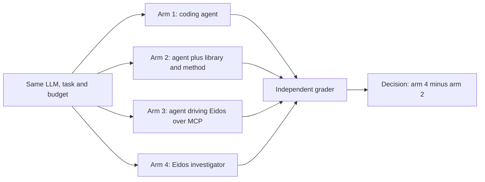
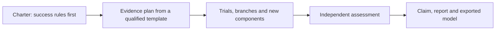
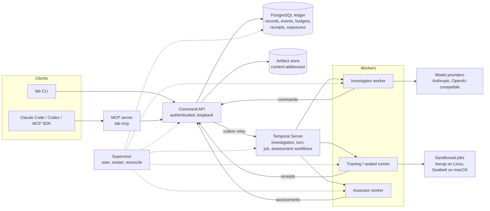

# Eidos

[](https://github.com/Legend101Zz/Eidos/actions/workflows/ci.yml) [](LICENSE)  

**A training harness that builds the scientific method into AI agents, so every model improvement they claim is independently verified.**

## Why Eidos exists

Agents are moving into the training loop. Some rewrite a run's optimizer code mid-run, and models are reported to write network weights directly. When an agent says it made a model better, how do we know?

Today's harnesses were built for software, where a test passes or fails the same way every time. Training gives noisy evidence, with error bars often wider than the gain being chased, and an agent that searches long enough will find a score that lies. The agent that ran the search is also tempted to grade it.

Science met these traps with human analysts and answered them with institutions: pre-registration, held-out confirmation and independent checking. Eidos puts those into the agent's scaffold, where they are enforced rather than remembered.

## How it works

- **Rules before results.** A charter commits the success rules before any result exists. Every look at a result is recorded.
- **Search apart from confirmation.** The agent explores on training and validation data; a locked candidate is then judged under an evidence plan frozen in advance.
- **Scoped claims.** Each claim says what it covers: a checkpoint, a recipe or an architecture.
- **Reserved budgets.** Tokens, cost, compute and time are reserved before work and settled after.
- **A separate assessor.** Only an assessor with its own identity reads held-out data and rules on a claim.

Underneath, one command API is the only write path, with idempotency keys so a crash cannot half-write a result. A PostgreSQL ledger records decisions and receipts, a content-addressed store holds artifacts, and Temporal runs durable workflows. Jobs run in sandboxed workers, and a credential broker keeps provider keys away from component code. Eidos has its own investigator agent, and an MCP server lets coding agents such as Claude Code drive the same lab.


## Research

A four-arm study fixed the model (MiniMax-M3.1-Flash) and budget and changed only the harness. An independent grader on two fresh virtual machines judged every outcome.

- In pilot 2 the Eidos investigator matched the strongest coding agent, 12 of 12 verified improvements each, on 5.5× fewer tokens.
- It made no false improvement claim in any pilot. All 14 of its conclusions in pilots 2 and 3 were confirmed by the grader.
- Eidos's components, given to an ordinary coding agent as a toolkit, made it the strongest or joint-strongest arm in every pilot.
- Pilot 3's setback, 2 of 12 against 11 of 12, came from one timing rule in Eidos's own runtime. Round 4 fixed it: on seven practice tasks, completed runs went from 2 of 7 to 7 of 7.

The evidence is exploratory: three small pilots. The paper reports the failures too.


### Research and evaluation

- [Paper (PDF): *Eidos: A Harness for Agents That Train Models*](docs/paper/Eidos-paper.pdf)
- [Study protocol](research/public/STUDY_PROTOCOL.md)
- [Pilot charters and addenda](docs/experiments/)
- [Independent two-VM grader (private until the sealed Pilot-4 study completes)](https://github.com/Legend101Zz/eidos-grading). This repository is private, so the link works only for people who have been given access.

**Current release: v1.1.0** ([release notes](docs/release/RELEASE_NOTES_v1.1.0.md), [status](#status-and-evidence)).

Contents: [Why](#why-eidos-exists) · [How it works](#how-it-works) · [Research](#research) · [How it stays honest](#how-eidos-keeps-the-investigator-honest) · [Study design](#the-research-behind-it) · [In detail](#how-it-works-in-detail) · [Key features](#key-features) · [Isolation](#isolation-model) · [Budgets](#budget-and-ledger-model) · [Install](#install) · [Quickstart](#quickstart) · [Scope](#supported-scope-v1) · [Status](#status-and-evidence) · [Docs](#documentation-map) · [Contributing](#contributing) · [Licence](#license)

## How Eidos keeps the investigator honest

Each habit of a careful researcher maps to something the harness enforces, rather than something the LLM is asked to remember:

| Habit of a careful researcher | What Eidos enforces |
|---|---|
| Decide what counts as success before looking | A **charter** with the success rules is committed before exploration. Plans cannot override its thresholds; a later change is a new revision that keeps the old rule and records what had been seen |
| Use a sound method | **Evidence plans** come from **qualified templates**: templates that have shown they detect a planted effect and stay silent on a null case |
| Let someone else judge | A separate **assessor**, qualified the same way, compares the frozen plan with what actually ran |
| Keep a lab notebook | Every run, cost, isolation receipt and **exposure** (who saw which result, and when) is in the ledger |
| Claim only what the evidence supports | Claims carry an assessed outcome and a scope; failures, nulls and inconclusive results are kept |

**A worked example** (the switch-order project in [`examples/switch-order-project`](examples/switch-order-project/)). A small PyTorch model must decide which of two switches fired first. One input, the "recorder", agrees with the label 98% of the time, which is a tempting shortcut. The useful metric is *both-correct*: the model gets an example **and** its order-swapped twin right. In the v1.0.0 real-model run, `claude-sonnet-5-5` worked as the investigator on its own ([`a8-sonnet-3-recheck.json`](docs/release/evidence/a8-sonnet-3-recheck.json)):

1. **Diagnosis.** The baseline had 0.984 accuracy but only 0.2625 both-correct, and 0 of 701 adjacent pairs were both correct. The investigator concluded that the model probably relies on the recorder shortcut, and wrote that it had not tested this directly.
2. **Fix.** Group-balanced training from scratch reached 0.467 both-correct but dropped accuracy to 0.7125, breaking the charter's guardrail, so it was not claimed. The same training continued on a **checkpoint branch** of the baseline reached 0.785 both-correct with accuracy 0.9955.
3. **Assessed result.** A frozen evidence plan ran baseline and candidate again; the numbers reproduced exactly. The independent assessor returned **inconclusive**. The investigator's report listed the weak points itself: one training seed, one evaluation draw, and 45 extra training steps that confound the comparison. It did not claim more than that.

The run cost USD 1.81 in model calls.

## The research behind it

The study asks one question: **does the same LLM make more independently verified, useful model improvements through Eidos than as a well-equipped coding agent?** To make that a fair test, it compares four arms that share one LLM, one task set and one resource envelope, so the only difference is what the LLM works through:

| Arm | What the LLM gets |
|---|---|
| 1 | A coding agent with a research brief and ordinary tools |
| 2 | Arm 1 plus the component library and written research method, without Eidos |
| 3 | The same coding agent operating Eidos through MCP |
| 4 | The Eidos internal investigator |



**Decision rule.** The primary contrast is arm 4 minus arm 2. A practically useful advantage needs at least +10 percentage points in verified success rate, with the lower end of the 95% confidence interval above +10 points. The owner fixed this rule before any comparative result.

**Exploratory results from three development pilots are in [Research](#research) and the [paper](docs/paper/Eidos-paper.pdf).** The public research release is [`research/public/`](research/public/) (release `research-public-v0.1.0`): the study protocol, 14 development task cards, the answer format and draft analysis code. The plan for running the study, and for testing the harness, is [`docs/experiments/README.md`](docs/experiments/README.md).

## How it works in detail

**The research loop.** An investigation moves through the same stages a careful researcher would, and each stage leaves a record:



The investigator works in **bounded turns**. Each turn reads the evidence from the ledger, makes one model decision, and runs the accepted actions with recorded command keys. Exploration is free between turns; claims go through the plan and the assessor.

**The architecture.**



- **Ledger.** Only the command service holds write credentials. Workers, the investigator and jobs act only through authenticated commands. Since migration 0004, writers from an older version are fenced after an upgrade.
- **Investigations.** An investigation is a coordinator workflow that starts one bounded turn at a time. A turn is: context from the ledger, then a model decision, then the accepted calls run with recorded command keys. Jobs outlive turns.

**The roles.**

| Role | What it does |
|---|---|
| Investigator | The LLM. Reads evidence, proposes and runs experiments, writes components; acts only through commands |
| Command service | The single write path: authenticates every caller, checks revisions and budgets, commits to the ledger |
| Ledger | PostgreSQL records of charters, runs, claims, plans, budgets, receipts and exposures |
| Workers | Separate processes that train, evaluate and score in the project's own Python environment |
| Assessor | A separate identity that checks a frozen plan against what actually ran and issues the verdict |
| Sandboxes | Isolate candidate code: bubblewrap on Linux, Seatbelt on macOS; each attempt gets an isolation receipt |
| Supervisor | Starts, health-checks, restarts and reconciles PostgreSQL, Temporal and the workers |


*The local v1 topology from the design (Revision 4, [`docs/design/`](docs/design/eidos-claude-handoff/architecture/model-research-harness-design.md)). It shows the designed system; what v1 supports is in [Supported scope](#supported-scope-v1).*

### Key features

- **Bounded, durable investigations.**
  - Turns run as Temporal workflows with persisted decisions and stable command keys.
  - A crashed worker resumes from the ledger.
  - Budgets (model tokens, USD, compute, trials) are reserved before work and settled after it.
- **Your project, unmodified.**
  - A thin adapter connects an existing PyTorch project.
  - The worker SDK is standard library only and installs nothing into your environment.
- **Research components.**
  - Training, evaluation, weight edits, behaviour checks and scorers are versioned, published releases.
  - The investigator can author new ones; they are validated before they are published.
- **Checkpoint branching.** Fork from immutable parents with explicit state migration, restore classes and cost accounting.
- **Evidence rules.**
  - Success rules are committed in a charter before exploration.
  - Plans come from qualified templates, and an assessor qualified with planted and null controls judges them.
  - Thresholds cannot be overridden.
- **Operator interfaces.** The `lab` CLI, an MCP server (stdio and loopback HTTP) and static HTML reports.
- **Local operations.** A supervisor manages PostgreSQL and Temporal, with `doctor`, backup and restore, upgrade, disk-pressure refusal and crash reconciliation.

### Isolation model

Every job attempt gets an isolation receipt from probes that actually ran, and the receipt records which controls held.
- **Linux, `linux:bwrap-sealed`.** Namespaces, read-only inputs, no network, no host writes, no credential or label reads, and a separate scorer process. This is the only profile for **sealed (hostile-code) evaluation**.
- **macOS, `macos:seatbelt-sealed`.**
  - `sandbox-exec` keeps the lab home, credentials and `$HOME` unreadable, allows no network, writes only to staging and scratch, and denies inspection of other processes.
  - It runs as the **same OS user**: launchd/XPC stay reachable by other routes, mach IPC is not filtered and signals are allowed. It does not contain a hostile same-user program.
  - So macOS labs **refuse plans that require sealed execution**, and a Seatbelt receipt never satisfies them.
- **`dev:same-user`.** Exploration only. Asking for it when a stronger profile is available needs a recorded waiver, which stays visible in locks, plans and assessments.

Details and limits: [`docs/release/SUPPORTED.md`](docs/release/SUPPORTED.md), [ADR 0006](docs/decisions/0006-macos-seatbelt-profile.md).

### Budget and ledger model

- Budgets are per investigation and per dimension: `model_tokens`, `model_usd` (at configured prices), `compute_seconds`, `trials`, `turns`.
- Each model decision reserves its worst-case envelope before any request and settles to the actual usage afterwards. A request that may have been charged before a timeout is recorded as uncertain usage.
- A retried call reuses its recorded command key, so a crash after a committed effect never admits work twice.
- Exposures (reads of outcomes) are recorded, so later claims can be checked against what was seen.

## What you can do with it today

Everything below runs on one machine: a laptop or workstation with Linux or macOS, no cloud account and no cluster. The lab manages its own PostgreSQL and Temporal services.

### Install

Requirements:
- Python 3.12 and [`uv`](https://docs.astral.sh/uv/);
- PostgreSQL 14 or later server binaries (for example Homebrew `postgresql@16`, or `postgresql-16` on Ubuntu);
- network access once, for the pinned, digest-verified Temporal Server download.

From source, build the wheels and install them into a fresh environment. This is what CI's `fresh-install` job and the macOS owner kit do:

```bash
git clone https://github.com/Legend101Zz/Eidos && cd Eidos
uv build --no-cache --all-packages -o dist
uv venv --python 3.12 ~/eidos-venv
uv pip install --no-cache --python ~/eidos-venv/bin/python --find-links dist eidos-lab
export PATH="$HOME/eidos-venv/bin:$PATH"
```

From release wheels: download the wheels attached to the GitHub release into `dist/`, then run the last two commands.

### Quickstart

**1. Create and start a lab.** The lab owns a private PostgreSQL cluster and a Temporal Server under its home directory.

```bash
lab init --home ~/eidos-lab --pg-bin /opt/homebrew/opt/postgresql@16/bin   # Linux: /usr/lib/postgresql/16/bin
export EIDOS_HOME=~/eidos-lab
lab start
lab doctor
```

**2. Register a project.** The switch-order example is used here; this is what the acceptance journey does.

```bash
lab project create demo --budget compute_seconds=20000 --budget trials=100
lab project register-env demo --python "$(command -v python3)" --root examples/switch-order-project --adapter eidos_adapter:ADAPTER
lab component install demo components/eidos.project.command
```

The project's own environment needs `torch`. Eidos records what is installed and never changes it.

**3. Connect Claude Code or Codex over MCP.** `lab mcp` is a stdio MCP server; clients launch it themselves. Generate client configurations with absolute paths:

```bash
python3 scripts/qualify/mcp_clients/gen_configs.py --home "$EIDOS_HOME" --lab "$(command -v lab)" --out ./mcp-configs
```

Then register the generated snippet in your client: `docs/ops/mcp-clients.md`. Claude Code and Codex CLI were verified on read and write paths (`docs/mac/receipts/a14-*.json`).

**4. Run an investigation.**
- Set `price_per_mtok` to your provider's current list price. A `model_usd` limit is refused without it, because it could not be enforced. A model provider key reaches only the investigator worker. Pass it on stdin: `printf 'ANTHROPIC_API_KEY=%s\n' "$KEY" | lab start --credentials-stdin` (stop the lab first).
- A charter with prospective success rules must be committed before exploration: `lab charter commit` (see `lab charter commit --help`).
- Then start the investigation:

```bash
lab investigate start demo --question "..." --charter <charter id> --runtime pydantic-ai \
  --model anthropic:claude-sonnet-5-5 --settings '{"price_per_mtok": {"input": 2.0, "output": 10.0}}' \
  --limit model_usd=2 --limit model_tokens=600000 --limit turns=12
lab investigate show demo <investigation id>
lab report demo --investigation <investigation id> --out-dir report/
lab stop
```

The complete, scripted version of this journey (setup, qualified protocols and a real-model investigation) is `tests/journeys/a8_live.py`. Operations guide: [`docs/ops/INSTALL_AND_OPERATE.md`](docs/ops/INSTALL_AND_OPERATE.md); problems: [`docs/ops/TROUBLESHOOTING.md`](docs/ops/TROUBLESHOOTING.md).

## Supported scope (v1)

| | Supported |
|---|---|
| Platforms | Linux x86_64, macOS arm64; CPU, plus MPS on macOS |
| Model providers | Anthropic; OpenAI-compatible endpoints (protocol; see G4 below) |
| MCP clients | Claude Code, Codex CLI, MCP Python SDK |
| Sealed (hostile-code) evaluation | Linux with bubblewrap only |

Out of scope, with reasons: Windows, CUDA, distributed training, Lima VM, Claude Desktop, hosted multitenancy. Details: [`docs/release/SUPPORTED.md`](docs/release/SUPPORTED.md).

The v1 software release makes **no scientific claim** of its own. Whether Eidos helps an LLM do model research (A16) is studied separately: the paper reports exploratory evidence from three development pilots, and a sealed fourth pilot follows; see [Research](#research).

## Status and evidence

| Gate | Result | Evidence |
|---|---|---|
| G1 licence | pass | `LICENSE`, `NOTICE`; wheel metadata checked in CI |
| G2 scope | pass | [`SUPPORTED.md`](docs/release/SUPPORTED.md) |
| G3 isolation honesty | pass | `tests/unit/test_seatbelt_policy.py`, `tests/integration/test_sealed_plan_refusal.py` |
| G4 OpenAI-compatible | adapter verified; no local model of 14B or less passed full conformance (`qwen2.5:14b`: 4/8). Since v1.1.0 the `json` output mode removes malformed-output failures (qwen2.5 3B: 1→5, 7B: 0→5 decisions of 5) but not semantic ones (executable 3B 1→2, 7B 0→1 of 5) | [`g4-*.json`](docs/release/evidence/), [`g4-110-summary.json`](docs/release/evidence/g4-110-summary.json) |
| G5 real-model investigation (A8) | pass: `claude-sonnet-5-5` completed the full journey autonomously. The run receipt failed one check because of a bug in the checking script's export loader; the checks were re-evaluated from the ledger, with no model call, in `a8-sonnet-3-recheck.json` | [`a8-sonnet-3*.json`](docs/release/evidence/) |
| G6 local operations | disk exhaustion, service kills and abrupt stop pass on macOS; **machine sleep/restart not verified on hardware** (released without it by owner decision) | [`g6-*.json`](docs/release/evidence/) |
| G7 review items | pass | `CHANGELOG.md` |
| G8 docs | pass | this page, `docs/` |
| G9 final verification (v1.0.0) | pass: suite 167 passed / 4 skipped, switch journey 154/154, macOS owner kit 15/15, CI 10/10, independent review | [`g9-*`](docs/release/evidence/), `ACCEPTANCE_MATRIX.md` § E |
| v1.0.1 follow-up | mypy 0 errors in CI (also at a Python 3.9 target for worker packages); wire JSON Schemas and 15 golden fixtures; suite 199 passed / 4 skipped, worker packages 22 passed / 1 skipped; CI 10/10 on `main` | [`RELEASE_NOTES_v1.0.1.md`](docs/release/RELEASE_NOTES_v1.0.1.md) |
| v1.1.0 features | all six items done (ADRs 0010–0015); 5 of the 6 `not-started` failure-table rows now verified; suite 371 passed / 7 skipped, worker SDK 26 passed; CI 15/15 on the release commit | [`RELEASE_NOTES_v1.1.0.md`](docs/release/RELEASE_NOTES_v1.1.0.md) |

CI runs 15 jobs on every push: lint and unit, integration (PostgreSQL and Temporal), worker compatibility, components, fresh install, macOS arm64, upgrade across releases, end-to-end journey, switch journey, a Temporal source-build fallback, and since v1.1.0 separate identity (as root), the OS secret store on macOS and Linux, and the PyGlove and Composer adapters. Full criteria: [`ACCEPTANCE_MATRIX.md`](ACCEPTANCE_MATRIX.md). Release notes: [`docs/release/RELEASE_NOTES_v1.1.0.md`](docs/release/RELEASE_NOTES_v1.1.0.md) (and [v1.0.1](docs/release/RELEASE_NOTES_v1.0.1.md), [v1.0.0](docs/release/RELEASE_NOTES_v1.0.0.md)). History: [`CHANGELOG.md`](CHANGELOG.md). Documents dated before 2026-11-09 cite earlier commit IDs: [`COMMIT_ID_MAP.md`](docs/release/COMMIT_ID_MAP.md).

## Documentation map

| Document | What |
|---|---|
| `docs/ops/INSTALL_AND_OPERATE.md` | install, projects, MCP, backup/restore, upgrade |
| `docs/ops/TROUBLESHOOTING.md` | symptoms, causes, fixes |
| `docs/ops/mcp-clients.md` | MCP server and client registration |
| `docs/author-guide/` | writing components and using the worker SDK |
| `docs/design/` | the design (immutable) |
| `docs/decisions/` | architecture decision records |
| `docs/mac/STATUS.md` | macOS qualification record |
| `docs/release/` | supported scope, release notes, evidence |
| [`docs/experiments/README.md`](docs/experiments/README.md) | experiments and testing plan (R0–R3), GitHub workflow, grading |
| [`CONTRIBUTING.md`](CONTRIBUTING.md) | branches, pull requests, CI, commit identity |
| `research/public/` | public research release: study protocol, task cards, answer format (immutable) |
| [`docs/paper/`](docs/paper/) | the research paper (PDF) and the figures used in this page |
| `ACCEPTANCE_MATRIX.md` | release acceptance criteria and gate results |

## Contributing

Start with [`CONTRIBUTING.md`](CONTRIBUTING.md): branches, pull requests, CI and commit identity. The research and testing work is planned in [`docs/experiments/README.md`](docs/experiments/README.md).

### Development

```bash
uv sync
uv run ruff check src tests && uv run lint-imports
bash scripts/ci/mypy.sh              # mypy: server at 3.12, worker packages also at a 3.9 target
uv run pytest tests/unit tests/mcp tests/reporting -q
EIDOS_TEST_PG_ADMIN=postgresql+psycopg://postgres:<password>@127.0.0.1:5432/postgres uv run pytest tests/integration -q
bash tests/journeys/run_ci.sh        # the 154-check switch-order acceptance journey from fresh wheels
```

Integration tests need a PostgreSQL superuser URL and, for workflow tests, a Temporal CLI (`EIDOS_TEMPORAL_CLI`). The workflow is in `.github/workflows/ci.yml`; see `docs/ops/CI.md`.

### Repository

| Path | What |
|---|---|
| `src/eidos` | lab: ledger, command service, API, workflows, investigator, supervisor, CLI, MCP, reports |
| `packages/` | `eidos-wire`, `eidos-worker-sdk`, `eidos-pytorch`: standard-library worker packages for research environments |
| `components/` | built-in research components |
| `examples/` | switch-order and image example projects |
| `research/public/` | imported public research release (immutable; its own notices; not covered by the licence below) |

## License

Apache License 2.0: [`LICENSE`](LICENSE), [`NOTICE`](NOTICE). The licence covers this repository except `research/public/`, which keeps its own notices (`research/public/development/NOTICES.md`). Third-party licences: [`docs/ops/LICENSES.md`](docs/ops/LICENSES.md).
