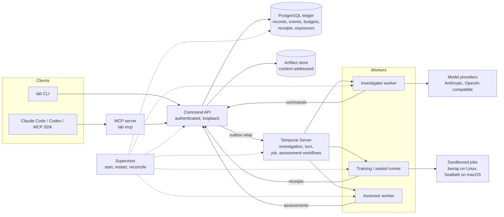

# Eidos

[](https://github.com/Legend101Zz/Eidos/actions/workflows/ci.yml) [](LICENSE)  

**A local research harness for investigating custom PyTorch models with an LLM investigator, under recorded evidence rules.**

Eidos is for ML researchers who want an LLM to help investigate their own PyTorch models on their own machine, without letting it grade its own work. An investigator diagnoses failures, writes and publishes research components, runs trials and checkpoint branches, and exports models. Claims count only when they come from a frozen, qualified evidence plan and an independent assessor. Every command, job, charge and isolation receipt is in a PostgreSQL ledger.

**Current release: v1.0.0** (package version `1.0.0`). Machine sleep and OS restart recovery are not yet verified on hardware; see [Status](#status-and-evidence).

## Key features

- **Bounded, durable investigations.**
  - Turns run as Temporal workflows with persisted decisions and stable command keys.
  - A crashed worker resumes from the ledger.
  - Budgets (model tokens, USD, compute, trials) are reserved before work and settled after it.
- **Your project, unmodified.**
  - A thin adapter connects an existing PyTorch project.
  - The worker SDK is standard library only and installs nothing into your environment.
- **Research components.**
  - Training, evaluation, weight edits, behaviour checks and scorers are versioned, published releases.
  - The investigator can author new ones; they are validated before they are published.
- **Checkpoint branching.** Fork from immutable parents with explicit state migration, restore classes and cost accounting.
- **Evidence rules.**
  - Success rules are committed in a charter before exploration.
  - Plans come from qualified templates, and an assessor qualified with planted and null controls judges them.
  - Thresholds cannot be overridden.
- **Operator interfaces.** The `lab` CLI, an MCP server (stdio and loopback HTTP) and static HTML reports.
- **Local operations.** A supervisor manages PostgreSQL and Temporal, with `doctor`, backup and restore, upgrade, disk-pressure refusal and crash reconciliation.

## Supported scope (v1)

| | Supported |
|---|---|
| Platforms | Linux x86_64, macOS arm64; CPU, plus MPS on macOS |
| Model providers | Anthropic; OpenAI-compatible endpoints (protocol; see G4 below) |
| MCP clients | Claude Code, Codex CLI, MCP Python SDK |
| Sealed (hostile-code) evaluation | Linux with bubblewrap only |

Out of scope, with reasons: Windows, CUDA, distributed training, Lima VM, Claude Desktop, hosted multitenancy. Details: [`docs/release/SUPPORTED.md`](docs/release/SUPPORTED.md).

v1 makes **no scientific claim**: whether Eidos helps an LLM do model research (A16) is a separate later release.

## Install

Requirements:
- Python 3.12 and [`uv`](https://docs.astral.sh/uv/);
- PostgreSQL 14 or later server binaries (for example Homebrew `postgresql@16`, or `postgresql-16` on Ubuntu);
- network access once, for the pinned, digest-verified Temporal Server download.

From source, build the wheels and install them into a fresh environment. This is what CI's `fresh-install` job and the macOS owner kit do:

```bash
git clone https://github.com/Legend101Zz/Eidos && cd Eidos
uv build --no-cache --all-packages -o dist
uv venv --python 3.12 ~/eidos-venv
uv pip install --no-cache --python ~/eidos-venv/bin/python --find-links dist eidos-lab
export PATH="$HOME/eidos-venv/bin:$PATH"
```

From release wheels: download the wheels attached to the GitHub release into `dist/`, then run the last two commands.

## Quickstart

**1. Create and start a lab.** The lab owns a private PostgreSQL cluster and a Temporal Server under its home directory.

```bash
lab init --home ~/eidos-lab --pg-bin /opt/homebrew/opt/postgresql@16/bin   # Linux: /usr/lib/postgresql/16/bin
export EIDOS_HOME=~/eidos-lab
lab start
lab doctor
```

**2. Register a project.** The switch-order example is used here; this is what the acceptance journey does.

```bash
lab project create demo --budget compute_seconds=20000 --budget trials=100
lab project register-env demo --python "$(command -v python3)" --root examples/switch-order-project --adapter eidos_adapter:ADAPTER
lab component install demo components/eidos.project.command
```

The project's own environment needs `torch`. Eidos records what is installed and never changes it.

**3. Connect Claude Code or Codex over MCP.** `lab mcp` is a stdio MCP server; clients launch it themselves. Generate client configurations with absolute paths:

```bash
python3 scripts/qualify/mcp_clients/gen_configs.py --home "$EIDOS_HOME" --lab "$(command -v lab)" --out ./mcp-configs
```

Then register the generated snippet in your client: `docs/ops/mcp-clients.md`. Claude Code and Codex CLI were verified on read and write paths (`docs/mac/receipts/a14-*.json`).

**4. Run an investigation.**
- Set `price_per_mtok` to your provider's current list price. A `model_usd` limit is refused without it, because it could not be enforced. A model provider key reaches only the investigator worker. Pass it on stdin: `printf 'ANTHROPIC_API_KEY=%s\n' "$KEY" | lab start --credentials-stdin` (stop the lab first).
- A charter with prospective success rules must be committed before exploration: `lab charter commit` (see `lab charter commit --help`).
- Then start the investigation:

```bash
lab investigate start demo --question "..." --charter <charter id> --runtime pydantic-ai \
  --model anthropic:claude-sonnet-5-5 --settings '{"price_per_mtok": {"input": 2.0, "output": 10.0}}' \
  --limit model_usd=2 --limit model_tokens=600000 --limit turns=12
lab investigate show demo <investigation id>
lab report demo --investigation <investigation id> --out-dir report/
lab stop
```

The complete, scripted version of this journey (setup, qualified protocols and a real-model investigation) is `tests/journeys/a8_live.py`. Operations guide: [`docs/ops/INSTALL_AND_OPERATE.md`](docs/ops/INSTALL_AND_OPERATE.md); problems: [`docs/ops/TROUBLESHOOTING.md`](docs/ops/TROUBLESHOOTING.md).

## Architecture



- **Ledger.** Only the command service holds write credentials. Workers, the investigator and jobs act only through authenticated commands. Since migration 0004, writers from an older version are fenced after an upgrade.
- **Investigations.** An investigation is a coordinator workflow that starts one bounded turn at a time. A turn is: context from the ledger, then a model decision, then the accepted calls run with recorded command keys. Jobs outlive turns.

## Isolation model

Every job attempt gets an isolation receipt from probes that actually ran, and the receipt records which controls held.
- **Linux, `linux:bwrap-sealed`.** Namespaces, read-only inputs, no network, no host writes, no credential or label reads, and a separate scorer process. This is the only profile for **sealed (hostile-code) evaluation**.
- **macOS, `macos:seatbelt-sealed`.**
  - `sandbox-exec` keeps the lab home, credentials and `$HOME` unreadable, allows no network, writes only to staging and scratch, and denies inspection of other processes.
  - It runs as the **same OS user**: launchd/XPC stay reachable by other routes, mach IPC is not filtered and signals are allowed. It does not contain a hostile same-user program.
  - So macOS labs **refuse plans that require sealed execution**, and a Seatbelt receipt never satisfies them.
- **`dev:same-user`.** Exploration only. Asking for it when a stronger profile is available needs a recorded waiver, which stays visible in locks, plans and assessments.

Details and limits: [`docs/release/SUPPORTED.md`](docs/release/SUPPORTED.md), [ADR 0006](docs/decisions/0006-macos-seatbelt-profile.md).

## Budget and ledger model

- Budgets are per investigation and per dimension: `model_tokens`, `model_usd` (at configured prices), `compute_seconds`, `trials`, `turns`.
- Each model decision reserves its worst-case envelope before any request and settles to the actual usage afterwards. A request that may have been charged before a timeout is recorded as uncertain usage.
- A retried call reuses its recorded command key, so a crash after a committed effect never admits work twice.
- Exposures (reads of outcomes) are recorded, so later claims can be checked against what was seen.

## Status and evidence

| Gate | Result | Evidence |
|---|---|---|
| G1 licence | pass | `LICENSE`, `NOTICE`; wheel metadata checked in CI |
| G2 scope | pass | [`SUPPORTED.md`](docs/release/SUPPORTED.md) |
| G3 isolation honesty | pass | `tests/unit/test_seatbelt_policy.py`, `tests/integration/test_sealed_plan_refusal.py` |
| G4 OpenAI-compatible | adapter verified; no local model of 14B or less passed full conformance (`qwen2.5:14b`: 4/8) | [`g4-*.json`](docs/release/evidence/) |
| G5 real-model investigation (A8) | pass: `claude-sonnet-5-5` completed the full journey autonomously. The run receipt failed one check because of a bug in the checking script's export loader; the checks were re-evaluated from the ledger, with no model call, in `a8-sonnet-3-recheck.json` | [`a8-sonnet-3*.json`](docs/release/evidence/) |
| G6 local operations | disk exhaustion, service kills and abrupt stop pass on macOS; **machine sleep/restart not verified on hardware** (released without it by owner decision) | [`g6-*.json`](docs/release/evidence/) |
| G7 review items | pass | `CHANGELOG.md` |
| G8 docs | pass | this page, `docs/` |
| G9 final verification | pass: suite 167 passed / 4 skipped, switch journey 154/154, macOS owner kit 15/15, CI 10/10, independent review | [`g9-*`](docs/release/evidence/), `ACCEPTANCE_MATRIX.md` § E |

CI runs 10 jobs on every push: lint and unit, integration (PostgreSQL and Temporal), worker compatibility, components, fresh install, macOS arm64, upgrade across releases, end-to-end journey, switch journey, and a Temporal source-build fallback. Full criteria: [`ACCEPTANCE_MATRIX.md`](ACCEPTANCE_MATRIX.md). Release notes: [`docs/release/RELEASE_NOTES_v1.0.0.md`](docs/release/RELEASE_NOTES_v1.0.0.md). History: [`CHANGELOG.md`](CHANGELOG.md). Documents dated before 2026-11-09 cite earlier commit IDs: [`COMMIT_ID_MAP.md`](docs/release/COMMIT_ID_MAP.md).

## Documentation map

| Document | What |
|---|---|
| `docs/ops/INSTALL_AND_OPERATE.md` | install, projects, MCP, backup/restore, upgrade |
| `docs/ops/TROUBLESHOOTING.md` | symptoms, causes, fixes |
| `docs/ops/mcp-clients.md` | MCP server and client registration |
| `docs/author-guide/` | writing components and using the worker SDK |
| `docs/design/` | the design (immutable) |
| `docs/decisions/` | architecture decision records |
| `docs/mac/STATUS.md` | macOS qualification record |
| `docs/release/` | supported scope, release notes, evidence |

## Development

```bash
uv sync
uv run ruff check src tests && uv run lint-imports
bash scripts/ci/mypy.sh              # mypy: server at 3.12, worker packages also at a 3.9 target
uv run pytest tests/unit tests/mcp tests/reporting -q
EIDOS_TEST_PG_ADMIN=postgresql+psycopg://postgres:<password>@127.0.0.1:5432/postgres uv run pytest tests/integration -q
bash tests/journeys/run_ci.sh        # the 154-check switch-order acceptance journey from fresh wheels
```

Integration tests need a PostgreSQL superuser URL and, for workflow tests, a Temporal CLI (`EIDOS_TEMPORAL_CLI`). The workflow is in `.github/workflows/ci.yml`; see `docs/ops/CI.md`.

## Repository

| Path | What |
|---|---|
| `src/eidos` | lab: ledger, command service, API, workflows, investigator, supervisor, CLI, MCP, reports |
| `packages/` | `eidos-wire`, `eidos-worker-sdk`, `eidos-pytorch`: standard-library worker packages for research environments |
| `components/` | built-in research components |
| `examples/` | switch-order and image example projects |
| `research/public/` | imported public research release (immutable; its own notices; not covered by the licence below) |

## License

Apache License 2.0: [`LICENSE`](LICENSE), [`NOTICE`](NOTICE). The licence covers this repository except `research/public/`, which keeps its own notices (`research/public/development/NOTICES.md`). Third-party licences: [`docs/ops/LICENSES.md`](docs/ops/LICENSES.md).
