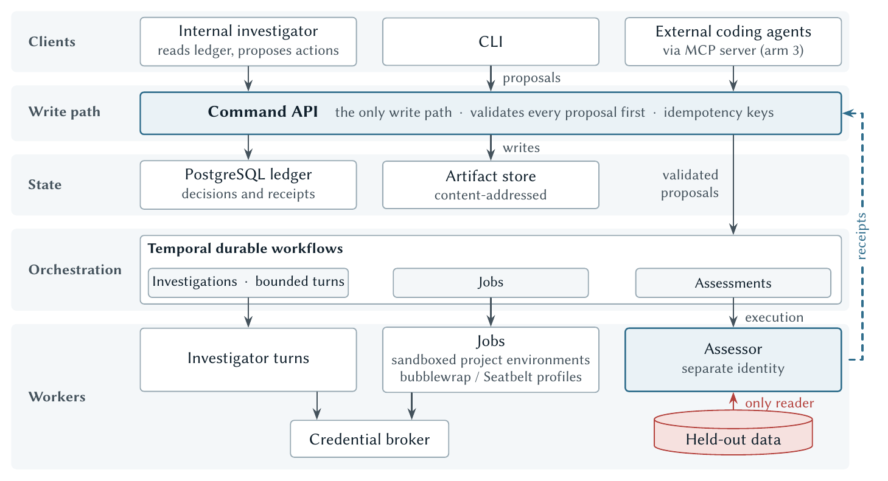
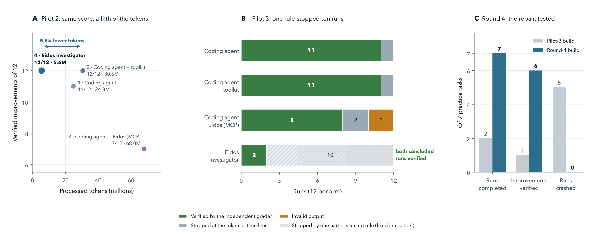
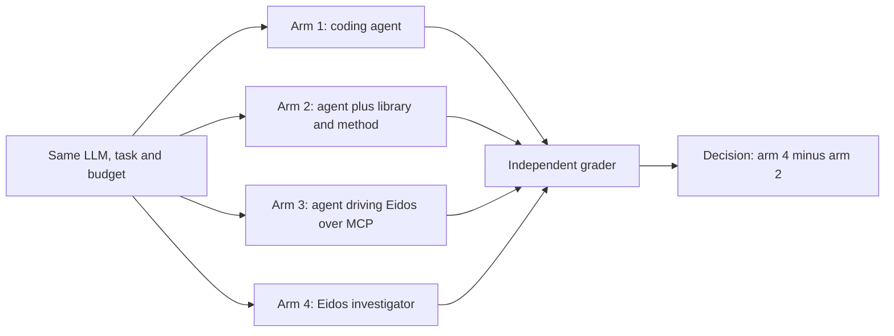
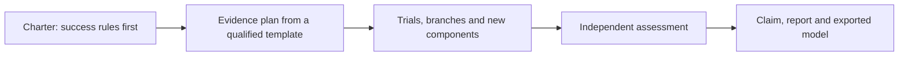
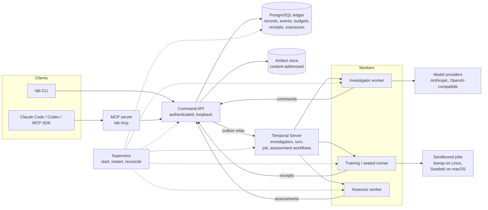
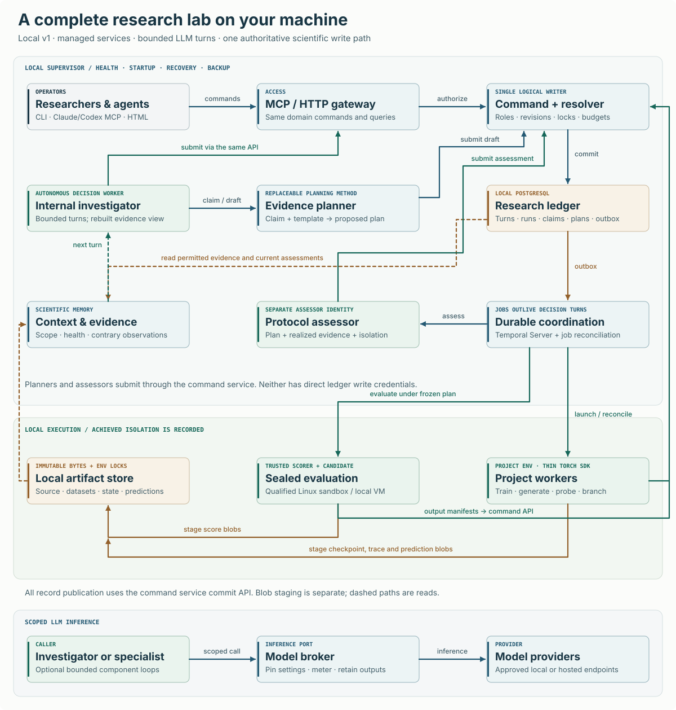

# Eidos

[](https://github.com/Legend101Zz/Eidos/actions/workflows/ci.yml) [](LICENSE)  

**A training harness that builds the scientific method into AI agents, so every model improvement they claim is independently verified.**

## Why Eidos exists

Agents are moving into the training loop. Some rewrite a run's optimizer code mid-run, and models are reported to write network weights directly. When an agent says it made a model better, how do we know?

Today's harnesses were built for software, where a test passes or fails the same way every time. Training gives noisy evidence, with error bars often wider than the gain being chased, and an agent that searches long enough will find a score that lies. The agent that ran the search is also tempted to grade it.

Science met these traps with human analysts and answered them with institutions: pre-registration, held-out confirmation and independent checking. Eidos puts those into the agent's scaffold, where they are enforced rather than remembered.

## How it works

- **Rules before results.** A charter commits the success rules before any result exists. Every look at a result is recorded.
- **Search apart from confirmation.** The agent explores on training and validation data; a locked candidate is then judged under an evidence plan frozen in advance.
- **Scoped claims.** Each claim says what it covers: a checkpoint, a recipe or an architecture.
- **Reserved budgets.** Tokens, cost, compute and time are reserved before work and settled after.
- **A separate assessor.** Only an assessor with its own identity reads held-out data and rules on a claim.

Underneath, one command API is the only write path, with idempotency keys so a crash cannot half-write a result. A PostgreSQL ledger records decisions and receipts, a content-addressed store holds artifacts, and Temporal runs durable workflows. Jobs run in sandboxed workers, and a credential broker keeps provider keys away from component code. Eidos has its own investigator agent, and an MCP server lets coding agents such as Claude Code drive the same lab.



## Research

Pilots 1 to 3 were a four-arm study. It fixed the model (MiniMax-M3.1-Flash) and budget and changed only the harness. An independent grader on two fresh virtual machines judged every outcome.

- In pilot 2 the Eidos investigator matched the strongest coding agent, 12 of 12 verified improvements each, on 5.5× fewer tokens.
- It made no false improvement claim in pilots 1 to 3. All 14 of its conclusions in pilots 2 and 3 were confirmed by the grader. (Pilot 4 is reported by hosted verdict only; see below.)
- Eidos's components, given to an ordinary coding agent as a toolkit, made it the strongest or joint-strongest arm in each of pilots 1 to 3.
- Pilot 3's setback, 2 of 12 against 11 of 12, came from one timing rule in Eidos's own runtime. Round 4 fixed it: on seven practice tasks, completed runs went from 2 of 7 to 7 of 7.

The evidence is exploratory: four small pilots. The paper reports the failures too.

### How Eidos has improved

The Eidos investigator (arm 4) across every pilot and development gate, next to the coding agent that has the Eidos toolkit (arm 2). Same model (MiniMax-M3.1-Flash) and per-run budget throughout; verified means confirmed by the independent grader.

| Stage | Eidos build | Cards | Eidos investigator | Coding agent + toolkit | Eidos tokens vs arm 2 |
|---|---|---|---:|---:|---:|
| Pilot 1 | v1 | D02, 3 runs | 1/3 verified | 3/3 | 7.5M vs 31.3M |
| Pilot 2 | round 2 | D03–D06, 12 runs | **12/12** verified | 12/12 | **5.6M vs 30.6M** |
| Pilot 3 | `257792a` | N01–N04, 12 runs | 2/12 verified (10 runs stopped by one timing rule) | 11/12 | 15.3M vs 30.5M |
| Round-4 gate | `e503821` | 7 practice cards | 7/7 completed, 6/7 verified | — | — |
| Gate G-R5 | `86dfe57` (R5) | 7 practice cards | **7/7 completed, 7/7 verified**, 0 crashes | — | — |
| **Pilot 4** | `86dfe57` | N05–N08, **sealed**, 24 runs | **20/24 verified, 24/24 completed, 0 crashes** | 19/24 | **24.0M vs 78.9M** |

**What has improved**

- **Reliability.** Pilot 3 was lost to the runtime, not the research: ten of twelve investigator runs were stopped by one deadline-admission rule. Three rounds of repair followed: the round-4 admission fix, the finalization contract, and R5's split wrap-up reserve ([ADR 0042](docs/decisions/0042-split-conclude-only-reserve.md)), each sized from measured data and checked by a registered gate. On sealed cards in Pilot 4, every one of the 24 investigator runs completed and none crashed, timed out or ran out of budget.
- **Efficiency.** In every pilot the investigator used several times fewer tokens than the coding agents for comparable success: 5.5× fewer in Pilot 2 and 3.3× fewer in Pilot 4.
- **Honesty.** No false improvement claim in pilots 1–3. Pilot 4's capture passed an independent audit with no leakage found within its scope.
- **Head to head.** On sealed cards the investigator now matches or slightly exceeds a coding agent that has the same toolkit: 0.833 against 0.792 family-balanced success.

**What has not improved yet**

- **Discovery.** When both arms succeed, they find equally good models. In Pilot 4 the gains were within 1.4% of each other on every card. On the hardest practice cards the investigator still reaches only 0.63 (N01) and 0.81 (N04) of the reference gain.
- **Statistical weight.** Pilot 4's advantage, +0.042 with an exploratory 95% interval of [−0.208, +0.333], is inconclusive under the registered rule. Its sign also depends on the registered run-status gate.
- **The comparison is a timeline, not a controlled experiment.** Cards, builds and arms changed between pilots, so this table shows how Eidos has developed, not a measured causal effect of any single repair.

**What comes next.** The next phase targets discovery quality directly. The v2 work is reviewed and on branches, but it has not yet passed a development gate:

- a diagnostic that no longer steers the investigator the wrong way;
- a generated practice-card harness with a guard that can reject changes that don't generalise;
- a diverse recipe portfolio selected by cross-validation;
- mechanical candidate preparation, so the investigator spends its time on research instead of rewriting code.

An internal improvement programme will iterate on these with fast, model-free and small live checks. The next confirmatory pilot runs on cards that were sealed in advance: N09–N12, and N13–N16, whose commitment is already public.

Before Pilot 4, the runtime was checked with paired development gates: arm 4 only, one seed, seven development cards, against the frozen baseline build. The full record is in [Benchmarks](#benchmarks).

- The gate for round-4 build `a7c5d19` (12 November 2026) failed. The candidate concluded 6 of 7 runs. D02 crashed in the conclude-only wrap-up: its final request had not returned when the decision deadline arrived. PR #24, which carries that build, was merged to `main` by owner decision after the failed gate.
- R5 ([ADR 0042](docs/decisions/0042-split-conclude-only-reserve.md), PR #27, merged as `f86fa10`) was the response. It raised the conclusion reserve from 10% to 15% of the wall and split it into a read slot, an armed request timeout and one decision-only fallback request. The sizes come from the measured latency of 2,117 real requests.
- Gate G-R5 was registered before it ran, and it passed on build `86dfe57`: 7 of 7 runs concluded and were verified, with no dead ends and no crashes. The frozen baseline concluded 1 of 7.

The fallback request never fired in that gate. N02 and N03 concluded under armed conclude-only requests, and D02 concluded in ordinary finalization. So the gate shows the larger, split reserve working on these seven runs. Only the tests show the fallback rescuing a hung request. The gate is also one seed on seven development cards that were already used for tuning: development evidence, not an estimate of performance. The gap in what the investigator finds on cards N01 and N04 (0.63 and 0.81 of the reference gain) remains.

**Pilot 4 ran on 13 November 2026 and is inconclusive.** From Pilot 4, each pilot compares the Eidos investigator (arm 4) with a coding agent given the Eidos toolkit (arm 2). Arms 1 and 3 were dropped after pilot 3. The primary contrast was always arm 4 against arm 2. The MCP arm was diagnosed as limited by its plumbing rather than by the harness. Two fewer arms also halves the cost of each paired comparison, which buys six paired runs per card instead of three. The decision rule is unchanged. The registered design was cards N05 to N08 (sealed), 24 paired blocks and 48 assignments, all kept in the denominator, on build `86dfe57` and the same model and envelope as before.

- **Result.** Verified improvements: arm 4 20 of 24, arm 2 19 of 24. Family-balanced success was 0.833 against 0.792, and the primary contrast (arm 4 minus arm 2) is **+0.042, with an exploratory 95% interval of [−0.208, +0.333]**. The registered rule needs an advantage of at least +0.10 with the lower end of the interval above +0.10. Pilot 4 shows no advantage of practical size, and the interval spans zero.
- **Quality.** Where both arms succeeded, the gains were essentially equal (arm 4's mean verified gain was within 1.4% of arm 2's on every card). Eidos found no larger improvements.
- **Resources.** Arm 4 processed 24.0M tokens against 78.9M for arm 2 (3.3× fewer) and used more wall time (median 1,368 s against 838 s per run). Arm 4's usage is flagged uncertain on 17 of its 24 runs, the arms count cache reads very differently, and billed cost is unknown, so the token ratio is not a cost ratio.
- **Completion.** All 24 arm-4 runs ended with run status ok: none crashed, timed out or stopped at the token ceiling. In Pilot 3, ten of twelve arm-4 runs had been stopped by one timing rule.

Limits. The sign of the estimate depends on the registered run-status gate: three arm-2 runs produced candidates the hosted grader verified but exceeded the token budget, and the gate counts them as failures (without it the contrast would be −0.083). The local pre-check disagreed with the hosted grade on nine arm-4 runs because the local grading workspace refused a write (`PermissionError`); the hosted grade is the verdict of record, and a local-only contrast would be −0.333, which measures that defect and not the arms. The four cards are hand-selected, each has one fixed dataset and split, and the builders had seen thresholds derived from the sealed baselines. It is an exploratory pilot, not evidence that Eidos beats a coding agent that has its toolkit.

Process. Pilot 4 was registered before its first run and then ran under five registered addenda: an earlier admission window (owner direction, before any model call), pay-as-you-go admission, an exhausted-weekly-status correction and a tooling-defect refusal recorded as an administrative non-admission (batch 13, block N05-r6, later admitted), and a post-run structural fix to capture validation that changed no estimator, rule or gate. One erratum: Addendum 4 says eight local `PermissionError`s, and the records show ten. A separate AI reviewer (not an outside party) audited the capture: 27 literal transcript matches, all benign, and no leakage found within that scope. Details and the full limits are in the [paper](docs/paper/Eidos-paper.pdf).



### Research and evaluation

- [Paper (PDF): *Eidos: A Harness for Agents That Train Models*](docs/paper/Eidos-paper.pdf)
- [Study protocol](research/public/STUDY_PROTOCOL.md)
- [Pilot charters and addenda](docs/experiments/)
- [ADR 0042: split the conclude-only reserve](docs/decisions/0042-split-conclude-only-reserve.md) (R5)
- [Development gate G-R5: registration](https://github.com/Legend101Zz/Eidos/blob/0ef3058df707e1c6699b2d6384cb8cf76b232f03/docs/experiments/development-gates/GATE-R5.md), pinned to commit `0ef3058`, made before the gate ran
- [Pilot 4: registered charter, addenda 1 to 4 and design](https://github.com/Legend101Zz/Eidos/tree/02e162dc70a17e5d80cb378651855af002f21bcd/docs/experiments/pilot-4), pinned to commit `02e162d`, which includes the Addendum 4 erratum (the first registration was `f40f03c`)
- [Independent two-VM grader (private, because it also holds the sealed task sets for later pilots)](https://github.com/Legend101Zz/eidos-grading). This repository is private, so the link works only for people who have been given access.

**Current release: v1.1.0** ([release notes](docs/release/RELEASE_NOTES_v1.1.0.md), [status](#status-and-evidence)). `main` is ahead of it: the changes since, including round 4 and R5, are listed as unreleased in the [changelog](CHANGELOG.md).

Contents: [Why](#why-eidos-exists) · [How it works](#how-it-works) · [Research](#research) · [Benchmarks](#benchmarks) · [How it stays honest](#how-eidos-keeps-the-investigator-honest) · [Study design](#the-research-behind-it) · [In detail](#how-it-works-in-detail) · [Key features](#key-features) · [Isolation](#isolation-model) · [Budgets](#budget-and-ledger-model) · [Install](#install) · [Quickstart](#quickstart) · [Scope](#supported-scope-v1) · [Testing](#testing) · [Status](#status-and-evidence) · [Docs](#documentation-map) · [Contributing](#contributing) · [Licence](#license)

## Benchmarks

**Four-arm study.** One model (MiniMax-M3.1-Flash), one budget (1,800 s, 8M processed tokens, one CPU thread), four harnesses. Every outcome is decided by an independent grader on two fresh virtual machines. Verified improvements:

| Arm | Pilot 1 (D02) | Pilot 2 | Pilot 3 | Processed tokens, pilots 1 / 2 / 3 |
|---|---:|---:|---:|---:|
| Coding agent (Claude Code `--bare`) | 2/3 | 11/12 | 11/12 | 33.7M / 24.8M / 31.6M |
| Coding agent + Eidos toolkit | **3/3** | **12/12** | **11/12** | 31.3M / 30.6M / 30.5M |
| Coding agent + Eidos (MCP) | 2/3 | 7/12 | 8/12 | 33.9M / 68.0M / 59.7M |
| Eidos investigator | 1/3 | **12/12** | 2/12 | **7.5M / 5.6M** / 15.3M |

- Pilot 3's 2/12 is ten runs stopped by one deadline-admission rule before they could report a locked candidate; both runs that reached a conclusion were verified. The round-4 repair (PR #24, now on `main`) took seven practice tasks from 2/7 to 7/7 completed runs and from 1 to 6 verified improvements, measured on build `e503821`. A later round-4 build, `a7c5d19`, failed its own gate (see below).
- The Eidos investigator made no false improvement claim in pilots 1 to 3 (Pilot 4 is reported by hosted verdict only).
- These are small development pilots. Every interval is exploratory; the pre-registered decision rule would need roughly 283 independent pairs, and Pilot 4, the largest, has 24.
- From Pilot 4 only arms 2 and 4 run (below).

**Pilot 4 (two arms, sealed cards, 13 November 2026).** Same model and envelope. The verdict of record is the hosted two-VM grade plus the run-status gate. Verified improvements, six runs per arm and card:

| Arm | N05 | N06 | N07 | N08 | Total | Family-balanced | Processed tokens | Wall |
|---|---:|---:|---:|---:|---:|---:|---:|---:|
| Coding agent + Eidos toolkit (arm 2) | 4/6 | 5/6 | 4/6 | 6/6 | 19/24 | 0.792 | 78.9M | 23,267 s |
| Eidos investigator (arm 4) | 6/6 | 5/6 | 4/6 | 5/6 | **20/24** | 0.833 | **24.0M** | 32,152 s |

Primary contrast, arm 4 minus arm 2: **+0.042, exploratory 95% interval [−0.208, +0.333]. Inconclusive** under the registered rule (needs a lower bound above +0.10). Mean verified gain, counting verified runs only (accuracy for N05 and N06, RMSE reduction for N07 and N08, so not comparable across cards):

| Card | Arm 2 | Arm 4 | Arm 4 − arm 2 |
|---|---:|---:|---:|
| N05 (accuracy) | +0.1875 | +0.1896 | +0.0021 |
| N06 (accuracy) | +0.4479 | +0.4421 | −0.0058 |
| N07 (RMSE reduction) | 297.64 | 297.48 | −0.155 |
| N08 (RMSE reduction) | 3.788 | 3.744 | −0.044 |

- Where both arms succeeded the gains are equal to within 1.4%: no larger improvements from Eidos.
- Arm 4 processed 3.3× fewer tokens but used more wall time (median 1,368 s against 838 s per run). Its usage is flagged uncertain on 17 of 24 runs, the arms count cache reads very differently (95% of arm 2's tokens, 3% of arm 4's), and billed cost is unknown.
- The sign depends on the registered run-status gate. Three arm-2 candidates that the hosted grader verified are counted as failures because their runs exceeded the 8M-token budget; without the gate the contrast would be −0.083.
- The local pre-check disagreed with the hosted grade on nine arm-4 runs because the local grading workspace refused a write (`PermissionError`). The hosted grade is the verdict of record; a local-only contrast (−0.333) measures that defect, not the arms. Addendum 4 says eight such errors; the records show ten (the nine plus N07-r5, where the hosted grade also failed).
- Four hand-selected cards, one fixed dataset and split each, and builders who had seen thresholds derived from the sealed baselines: exploratory only. Cross-pilot comparisons do not show what the build repair did, because cards, arms and build all changed.

**Development gates.** A development gate checks a new build before a pilot. It runs arm 4 only, with one seed, the same model, the same envelope (1,800 s, 8M processed tokens, one CPU thread) and the same seven development cards (N01–N04, D02–D04). The frozen baseline build `257792a` runs the same cards for comparison. The G-R5 rule, fixed before launch, was 7 of 7 candidate conclusions, zero dead ends, the existing evidence checks, and a zero-tolerance comparator against the baseline. Its registration says a failed gate is recorded and diagnosed, then followed by a fix and a new registration, and is never re-run, reinterpreted or waived. Scored attempts, one row per candidate build:

| Candidate build | Candidate: concluded, verified | Baseline: concluded, verified | Result |
|---|---:|---:|---|
| `454a9a6` | 5/7, 3/7 | not run | failed |
| `daa689c` | 6/7, 6/7 | not run | failed |
| `f0d1856` | 6/7, 5/7 | not run | failed |
| `46b29e3` | 7/7, 5/7 | not run | failed |
| `e503821` | 7/7, 6/7 | 2/7, 1/7 | passed |
| `a7c5d19` | 6/7, 6/7 | 2/7, 2/7 | failed: D02 crashed in the conclude-only wrap-up |
| `86dfe57` (R5) | **7/7, 7/7** | 1/7, 1/7 | **passed** (gate G-R5) |

Two earlier `a7c5d19` attempts, a quota wait with no model start and a host sleep, have no complete scorecard.

**Gate G-R5.** Registered before any model call of the gate, on candidate `86dfe57` (R5, the head of PR #27). Gain ratio is the verified gain divided by the coding-arm median gain on that card, from a reference file frozen from pilot 3. An unverified run counts as zero.

| Card | N01 | N02 | N03 | N04 | D03 | D04 | D02 |
|---|---:|---:|---:|---:|---:|---:|---|
| Candidate `86dfe57`, gain ratio | 0.625 | 0.967 | 1.017 | 0.810 | 1.009 | 1.000 | verified, no reference |
| Baseline `257792a` | crash | crash | crash | crash | 1.009 | crash | crash |

- Candidate: 7/7 concluded, 7/7 verified, 0 dead ends, 0 crashes, median gain ratio 0.983 over the six cards with a reference. Baseline: 1/7 concluded and verified, 6 crashes, 6 dead ends. The comparator found no regression and no blocker.
- The fallback request never fired. N02 and N03 concluded under armed conclude-only requests and D02 in ordinary finalization. The gate therefore shows the larger, split reserve working on these seven runs. It does not show the fallback rescuing a hung request; only the tests show that.
- One seed on seven development cards that were already used for tuning is development evidence, not a performance estimate.
- The gap on N01 and N04 remains: the investigator reached 0.63 and 0.81 of the reference gain there.

**What R5 changed, and why.** On `a7c5d19`, D02's final conclude-only request was still in flight when the decision deadline arrived, and the run was recorded as a crash. R5 ([ADR 0042](docs/decisions/0042-split-conclude-only-reserve.md)) raised the conclusion reserve from 10% to 15% of the wall (on an 1,800 s run, 270 s instead of 180 s) and split it into a read slot, an armed request timeout and one decision-only fallback request. The sizes follow the measured latency of 2,117 real requests: among 28 answered conclude-only final requests, 57% returned within 60 s, 82% within 90 s, 89% within 120 s and 96% within 150 s, and two more never returned. The ADR records that this does not establish a counterfactual result for D02.

**A stronger driver** (unregistered probe, one run per card). With Claude Opus 5.5 in the MCP arm, both runs verified: D03 at +0.278 (0.65M tokens, 127 s) and D06 at +0.496 (1.01M tokens, 154 s). MiniMax in the same seat verified 1/3 and 2/3 on those cards. Opus used Eidos sparingly, so this does not yet show what Eidos adds for a strong model.

**Model conformance.** No local model of 14B parameters or fewer passed full release conformance (best: `qwen2.5:14b`, 4/8), and `claude-sonnet-5-5` completed the full autonomous investigation journey. Details are in [Status and evidence](#status-and-evidence).

Methods, statistics and the full defect record: [the paper](docs/paper/Eidos-paper.pdf).

## How Eidos keeps the investigator honest

Each habit of a careful researcher maps to something the harness enforces, rather than something the LLM is asked to remember:

| Habit of a careful researcher | What Eidos enforces |
|---|---|
| Decide what counts as success before looking | A **charter** with the success rules is committed before exploration. Plans cannot override its thresholds; a later change is a new revision that keeps the old rule and records what had been seen |
| Use a sound method | **Evidence plans** come from **qualified templates**: templates that have shown they detect a planted effect and stay silent on a null case |
| Let someone else judge | A separate **assessor**, qualified the same way, compares the frozen plan with what actually ran |
| Keep a lab notebook | Every run, cost, isolation receipt and **exposure** (who saw which result, and when) is in the ledger |
| Claim only what the evidence supports | Claims carry an assessed outcome and a scope; failures, nulls and inconclusive results are kept |

**A worked example** (the switch-order project in [`examples/switch-order-project`](examples/switch-order-project/)). A small PyTorch model must decide which of two switches fired first. One input, the "recorder", agrees with the label 98% of the time, which is a tempting shortcut. The useful metric is *both-correct*: the model gets an example **and** its order-swapped twin right. In the v1.0.0 real-model run, `claude-sonnet-5-5` worked as the investigator on its own ([`a8-sonnet-3-recheck.json`](docs/release/evidence/a8-sonnet-3-recheck.json)):

1. **Diagnosis.** The baseline had 0.984 accuracy but only 0.2625 both-correct, and 0 of 701 adjacent pairs were both correct. The investigator concluded that the model probably relies on the recorder shortcut, and wrote that it had not tested this directly.
2. **Fix.** Group-balanced training from scratch reached 0.467 both-correct but dropped accuracy to 0.7125, breaking the charter's guardrail, so it was not claimed. The same training continued on a **checkpoint branch** of the baseline reached 0.785 both-correct with accuracy 0.9955.
3. **Assessed result.** A frozen evidence plan ran baseline and candidate again; the numbers reproduced exactly. The independent assessor returned **inconclusive**. The investigator's report listed the weak points itself: one training seed, one evaluation draw, and 45 extra training steps that confound the comparison. It did not claim more than that.

The run cost USD 1.81 in model calls.

## The research behind it

The study asks one question: **does the same LLM make more independently verified, useful model improvements through Eidos than as a well-equipped coding agent?** To make that a fair test, it compares four arms that share one LLM, one task set and one resource envelope, so the only difference is what the LLM works through:

| Arm | What the LLM gets |
|---|---|
| 1 | A coding agent with a research brief and ordinary tools |
| 2 | Arm 1 plus the component library and written research method, without Eidos |
| 3 | The same coding agent operating Eidos through MCP |
| 4 | The Eidos internal investigator |

Pilots 1 to 3 ran all four arms. From Pilot 4 only arms 2 and 4 run, because the primary contrast was always arm 4 against arm 2 (see [Research](#research)).



**Decision rule.** The primary contrast is arm 4 minus arm 2. A practically useful advantage needs at least +10 percentage points in verified success rate, with the lower end of the 95% confidence interval above +10 points. The owner fixed this rule before any comparative result.

**Exploratory results from four development pilots are in [Research](#research) and the [paper](docs/paper/Eidos-paper.pdf).** The public research release is [`research/public/`](research/public/) (release `research-public-v0.1.0`): the study protocol, 14 development task cards, the answer format and draft analysis code. The plan for running the study, and for testing the harness, is [`docs/experiments/README.md`](docs/experiments/README.md).

## How it works in detail

**The research loop.** An investigation moves through the same stages a careful researcher would, and each stage leaves a record:



The investigator works in **bounded turns**. Each turn reads the evidence from the ledger, makes one model decision, and runs the accepted actions with recorded command keys. Exploration is free between turns; claims go through the plan and the assessor.

**The architecture.**



- **Ledger.** Only the command service holds write credentials. Workers, the investigator and jobs act only through authenticated commands. Since migration 0004, writers from an older version are fenced after an upgrade.
- **Investigations.** An investigation is a coordinator workflow that starts one bounded turn at a time. A turn is: context from the ledger, then a model decision, then the accepted calls run with recorded command keys. Jobs outlive turns.

**The roles.**

| Role | What it does |
|---|---|
| Investigator | The LLM. Reads evidence, proposes and runs experiments, writes components; acts only through commands |
| Command service | The single write path: authenticates every caller, checks revisions and budgets, commits to the ledger |
| Ledger | PostgreSQL records of charters, runs, claims, plans, budgets, receipts and exposures |
| Workers | Separate processes that train, evaluate and score in the project's own Python environment |
| Assessor | A separate identity that checks a frozen plan against what actually ran and issues the verdict |
| Sandboxes | Isolate candidate code: bubblewrap on Linux, Seatbelt on macOS; each attempt gets an isolation receipt |
| Supervisor | Starts, health-checks, restarts and reconciles PostgreSQL, Temporal and the workers |



*The local v1 topology from the design (Revision 4, [`docs/design/`](docs/design/eidos-claude-handoff/architecture/model-research-harness-design.md)). It shows the designed system; what v1 supports is in [Supported scope](#supported-scope-v1).*

### Key features

- **Bounded, durable investigations.**
  - Turns run as Temporal workflows with persisted decisions and stable command keys.
  - A crashed worker resumes from the ledger.
  - Budgets (model tokens, USD, compute, trials) are reserved before work and settled after it.
- **Your project, unmodified.**
  - A thin adapter connects an existing PyTorch project.
  - The worker SDK is standard library only and installs nothing into your environment.
- **Research components.**
  - Training, evaluation, weight edits, behaviour checks and scorers are versioned, published releases.
  - The investigator can author new ones; they are validated before they are published.
- **Checkpoint branching.** Fork from immutable parents with explicit state migration, restore classes and cost accounting.
- **Evidence rules.**
  - Success rules are committed in a charter before exploration.
  - Plans come from qualified templates, and an assessor qualified with planted and null controls judges them.
  - Thresholds cannot be overridden.
- **Operator interfaces.** The `lab` CLI, an MCP server (stdio and loopback HTTP) and static HTML reports.
- **Local operations.** A supervisor manages PostgreSQL and Temporal, with `doctor`, backup and restore, upgrade, disk-pressure refusal and crash reconciliation.

### Isolation model

Every job attempt gets an isolation receipt from probes that actually ran, and the receipt records which controls held.
- **Linux, `linux:bwrap-sealed`.** Namespaces, read-only inputs, no network, no host writes, no credential or label reads, and a separate scorer process. This is the only profile for **sealed (hostile-code) evaluation**.
- **macOS, `macos:seatbelt-sealed`.**
  - `sandbox-exec` keeps the lab home, credentials and `$HOME` unreadable, allows no network, writes only to staging and scratch, and denies inspection of other processes.
  - It runs as the **same OS user**: launchd/XPC stay reachable by other routes, mach IPC is not filtered and signals are allowed. It does not contain a hostile same-user program.
  - So macOS labs **refuse plans that require sealed execution**, and a Seatbelt receipt never satisfies them.
- **`dev:same-user`.** Exploration only. Asking for it when a stronger profile is available needs a recorded waiver, which stays visible in locks, plans and assessments.

Details and limits: [`docs/release/SUPPORTED.md`](docs/release/SUPPORTED.md), [ADR 0006](docs/decisions/0006-macos-seatbelt-profile.md).

### Budget and ledger model

- Budgets are per investigation and per dimension: `model_tokens`, `model_usd` (at configured prices), `compute_seconds`, `trials`, `turns`.
- Each model decision reserves its worst-case envelope before any request and settles to the actual usage afterwards. A request that may have been charged before a timeout is recorded as uncertain usage.
- A retried call reuses its recorded command key, so a crash after a committed effect never admits work twice.
- Exposures (reads of outcomes) are recorded, so later claims can be checked against what was seen.

## What you can do with it today

Everything below runs on one machine: a laptop or workstation with Linux or macOS, no cloud account and no cluster. The lab manages its own PostgreSQL and Temporal services.

### Install

Requirements:
- Python 3.12 and [`uv`](https://docs.astral.sh/uv/);
- PostgreSQL 14 or later server binaries (for example Homebrew `postgresql@16`, or `postgresql-16` on Ubuntu);
- network access once, for the pinned, digest-verified Temporal Server download.

From source, build the wheels and install them into a fresh environment. This is what CI's `fresh-install` job and the macOS owner kit do:

```bash
git clone https://github.com/Legend101Zz/Eidos && cd Eidos
uv build --no-cache --all-packages -o dist
uv venv --python 3.12 ~/eidos-venv
uv pip install --no-cache --python ~/eidos-venv/bin/python --find-links dist eidos-lab
export PATH="$HOME/eidos-venv/bin:$PATH"
```

From release wheels: download the wheels attached to the GitHub release into `dist/`, then run the last two commands.

### Quickstart

**1. Create and start a lab.** The lab owns a private PostgreSQL cluster and a Temporal Server under its home directory.

```bash
lab init --home ~/eidos-lab --pg-bin /opt/homebrew/opt/postgresql@16/bin   # Linux: /usr/lib/postgresql/16/bin
export EIDOS_HOME=~/eidos-lab
lab start
lab doctor
```

**2. Register a project.** The switch-order example is used here; this is what the acceptance journey does.

```bash
lab project create demo --budget compute_seconds=20000 --budget trials=100
lab project register-env demo --python "$(command -v python3)" --root examples/switch-order-project --adapter eidos_adapter:ADAPTER
lab component install demo components/eidos.project.command
```

The project's own environment needs `torch`. Eidos records what is installed and never changes it.

**3. Connect Claude Code or Codex over MCP.** `lab mcp` is a stdio MCP server; clients launch it themselves. Generate client configurations with absolute paths:

```bash
python3 scripts/qualify/mcp_clients/gen_configs.py --home "$EIDOS_HOME" --lab "$(command -v lab)" --out ./mcp-configs
```

Then register the generated snippet in your client: `docs/ops/mcp-clients.md`. Claude Code and Codex CLI were verified on read and write paths (`docs/mac/receipts/a14-*.json`).

**4. Run an investigation.**
- Set `price_per_mtok` to your provider's current list price. A `model_usd` limit is refused without it, because it could not be enforced. A model provider key reaches only the investigator worker. Pass it on stdin: `printf 'ANTHROPIC_API_KEY=%s\n' "$KEY" | lab start --credentials-stdin` (stop the lab first).
- A charter with prospective success rules must be committed before exploration: `lab charter commit` (see `lab charter commit --help`).
- Then start the investigation:

```bash
lab investigate start demo --question "..." --charter <charter id> --runtime pydantic-ai \
  --model anthropic:claude-sonnet-5-5 --settings '{"price_per_mtok": {"input": 2.0, "output": 10.0}}' \
  --limit model_usd=2 --limit model_tokens=600000 --limit turns=12
lab investigate show demo <investigation id>
lab report demo --investigation <investigation id> --out-dir report/
lab stop
```

The complete, scripted version of this journey (setup, qualified protocols and a real-model investigation) is `tests/journeys/a8_live.py`. Operations guide: [`docs/ops/INSTALL_AND_OPERATE.md`](docs/ops/INSTALL_AND_OPERATE.md); problems: [`docs/ops/TROUBLESHOOTING.md`](docs/ops/TROUBLESHOOTING.md).

## Supported scope (v1)

| | Supported |
|---|---|
| Platforms | Linux x86_64, macOS arm64; CPU, plus MPS on macOS |
| Model providers | Anthropic; OpenAI-compatible endpoints (protocol; see G4 below) |
| MCP clients | Claude Code, Codex CLI, MCP Python SDK |
| Sealed (hostile-code) evaluation | Linux with bubblewrap only |

Out of scope, with reasons: Windows, CUDA, distributed training, Lima VM, Claude Desktop, hosted multitenancy. Details: [`docs/release/SUPPORTED.md`](docs/release/SUPPORTED.md).

The v1 software release makes **no scientific claim** of its own. Whether Eidos helps an LLM do model research (A16) is studied separately: the paper reports exploratory evidence from four development pilots, the fourth on sealed cards and inconclusive; see [Research](#research).

## Testing

Eidos is tested at four levels. The table counts are from a `main` CI run ([43003521253](https://github.com/Legend101Zz/Eidos/actions/runs/43003521253), 15/15 jobs green) taken before round 4 (PR #24) and R5 (PR #27) were merged. Counts for those changes follow the table.

| Level | What it covers | `main` before round 4 |
|---|---|---|
| Unit, MCP and reporting | ledger rules, validators, policies, MCP tools and reports | 2,036 passed |
| Integration | real PostgreSQL 16 and Temporal: investigations, jobs, assessments and budgets | 450 passed |
| Components | the built-in research components, on CPU PyTorch | 344 passed |
| Platform and install | worker SDK on Python 3.9+, macOS arm64, separate identity as root, OS secret stores (macOS and Linux), PyGlove and Composer adapters, fresh install, upgrade across releases, the 154-check switch-order journey | all jobs pass |

The study harness has its own tests (`study/tests`, `study/eidos_arms/test_parity.py`), and the grader is qualified on planted improvements, unchanged baselines, invalid outputs and corrupt uploads before use.

- **Round 4.** The round-4 branch (PR #24, now merged) passed 754 integration and 660 component tests in CI.
- **R5.** R5 added unit tests for the split reserve (64 cases in `tests/unit/test_conclude_split.py`), and a real-coordinator test with 12 cases run against PostgreSQL and the real ledger (`tests/integration/test_r5_conclude_split.py`). It reproduces D02's sequence: the move into ordinary finalization, an abandoned conclude-only request and the fallback. The cases cover JSON and native tool modes, zero, one or two read rounds, and a fallback that concludes or also hangs. CI on `86dfe57`, the head of PR #27, passed all 15 jobs and the separate `study-evals` workflow.
- **R5 local run.** On `86dfe57` a local run passed 2,712 unit tests (12 real-keychain and secret-tool tests deselected), 325 MCP and reporting tests, 635 integration tests, 45 study contract, parity and grading tests, and 91 `study/tests`. These are local counts, not CI counts. The local run had no Temporal CLI, so 132 workflow tests were among the 143 skipped integration tests. The R5 timing tests also ran in separate processes, 20 times for the unit file and 5 times for the integration file, and passed every time.

These tests use synthetic providers and accelerated clocks. They show control flow and accounting. They do not show better live success rates, and they cannot show that the fallback would have rescued D02.

- **Pilot 4 as a live test (13 November 2026).** On the R5 build, all 24 arm-4 runs on sealed cards ended with run status ok: none crashed, timed out or stopped at the token ceiling. That is evidence about completion behaviour, not a success-rate estimate; the result itself is inconclusive (see [Research](#research)).
- **Study tooling.** Before reporting, the Pilot 4 capture tooling passed a read-only structural dry-run (200 independent gates, including all 24 arm-4 question hashes and all 24 arm-2 render and delivery pairs, with the estimator disabled), and a separate AI reviewer audited the capture. The live run also exposed a defect in the local grading pre-check: its workspace refused a receipt write (`PermissionError`) in ten arm-4 grades, nine of which contradicted the hosted grade. The hosted grade is the verdict of record, and the local pre-check was not used for the Pilot 4 result.

To run the suites locally, see [Development](#development).

## Status and evidence

| Gate | Result | Evidence |
|---|---|---|
| G1 licence | pass | `LICENSE`, `NOTICE`; wheel metadata checked in CI |
| G2 scope | pass | [`SUPPORTED.md`](docs/release/SUPPORTED.md) |
| G3 isolation honesty | pass | `tests/unit/test_seatbelt_policy.py`, `tests/integration/test_sealed_plan_refusal.py` |
| G4 OpenAI-compatible | adapter verified; no local model of 14B or less passed full conformance (`qwen2.5:14b`: 4/8). Since v1.1.0 the `json` output mode removes malformed-output failures (qwen2.5 3B: 1→5, 7B: 0→5 decisions of 5) but not semantic ones (executable 3B 1→2, 7B 0→1 of 5) | [`g4-*.json`](docs/release/evidence/), [`g4-110-summary.json`](docs/release/evidence/g4-110-summary.json) |
| G5 real-model investigation (A8) | pass: `claude-sonnet-5-5` completed the full journey autonomously. The run receipt failed one check because of a bug in the checking script's export loader; the checks were re-evaluated from the ledger, with no model call, in `a8-sonnet-3-recheck.json` | [`a8-sonnet-3*.json`](docs/release/evidence/) |
| G6 local operations | disk exhaustion, service kills and abrupt stop pass on macOS; **machine sleep/restart not verified on hardware** (released without it by owner decision) | [`g6-*.json`](docs/release/evidence/) |
| G7 review items | pass | `CHANGELOG.md` |
| G8 docs | pass | this page, `docs/` |
| G9 final verification (v1.0.0) | pass: suite 167 passed / 4 skipped, switch journey 154/154, macOS owner kit 15/15, CI 10/10, independent review | [`g9-*`](docs/release/evidence/), `ACCEPTANCE_MATRIX.md` § E |
| v1.0.1 follow-up | mypy 0 errors in CI (also at a Python 3.9 target for worker packages); wire JSON Schemas and 15 golden fixtures; suite 199 passed / 4 skipped, worker packages 22 passed / 1 skipped; CI 10/10 on `main` | [`RELEASE_NOTES_v1.0.1.md`](docs/release/RELEASE_NOTES_v1.0.1.md) |
| v1.1.0 features | all six items done (ADRs 0010–0015); 5 of the 6 `not-started` failure-table rows now verified; suite 371 passed / 7 skipped, worker SDK 26 passed; CI 15/15 on the release commit | [`RELEASE_NOTES_v1.1.0.md`](docs/release/RELEASE_NOTES_v1.1.0.md) |
| Round-4 development gate (`a7c5d19`, 12 Nov 2026) | **fail**: candidate 6/7 concluded and 6/7 verified; D02 crashed in the conclude-only wrap-up. PR #24 was merged to `main` by owner decision despite the failed gate | [ADR 0042](docs/decisions/0042-split-conclude-only-reserve.md) records the D02 diagnosis; run records are private |
| R5 (ADR 0042, PR #27) | merged as `f86fa10`; conclusion reserve 10% → 15% of the wall, split into a read slot, an armed request timeout and one decision-only fallback; CI on `86dfe57` passed all 15 jobs and `study-evals`. The tests use synthetic providers, so they show control flow and accounting, not live success rates | [ADR 0042](docs/decisions/0042-split-conclude-only-reserve.md), [`CHANGELOG.md`](CHANGELOG.md), [Testing](#testing) |
| Development gate G-R5 (`86dfe57`, registered before it ran) | **pass**: 7/7 concluded and verified, 0 dead ends, 0 crashes, median gain ratio 0.983; frozen baseline `257792a` 1/7. One seed on seven development cards, so development evidence only. The fallback request never fired; the N01 and N04 discovery gap remains | [registration](https://github.com/Legend101Zz/Eidos/blob/0ef3058df707e1c6699b2d6384cb8cf76b232f03/docs/experiments/development-gates/GATE-R5.md); scorecards are private; [Benchmarks](#benchmarks) |
| Pilot 4 (arm 4 vs arm 2) | **run, inconclusive** (13 Nov 2026; registered at `f40f03c`, last addendum `6350616`). Cards N05–N08, 48 assignments, build `86dfe57`. Verified 20/24 (arm 4) against 19/24 (arm 2); contrast +0.042, exploratory 95% interval [−0.208, +0.333]; decision rule unchanged, so no practical advantage shown. The sign depends on the registered run-status gate (−0.083 without it); the local pre-check had a `PermissionError` defect on nine arm-4 runs (hosted grade is the verdict of record); five registered addenda and one erratum; independent AI audit found no leakage within its literal-match scope. Exploratory | [charter, addenda and design](https://github.com/Legend101Zz/Eidos/tree/02e162dc70a17e5d80cb378651855af002f21bcd/docs/experiments/pilot-4); [Research](#research); [Benchmarks](#benchmarks) |

CI runs 15 jobs on every push: lint and unit, integration (PostgreSQL and Temporal), worker compatibility, components, fresh install, macOS arm64, upgrade across releases, end-to-end journey, switch journey, a Temporal source-build fallback, and since v1.1.0 separate identity (as root), the OS secret store on macOS and Linux, and the PyGlove and Composer adapters. A separate `study-evals` workflow runs on pull requests that change `study/`. Full criteria: [`ACCEPTANCE_MATRIX.md`](ACCEPTANCE_MATRIX.md). Release notes: [`docs/release/RELEASE_NOTES_v1.1.0.md`](docs/release/RELEASE_NOTES_v1.1.0.md) (and [v1.0.1](docs/release/RELEASE_NOTES_v1.0.1.md), [v1.0.0](docs/release/RELEASE_NOTES_v1.0.0.md)). History: [`CHANGELOG.md`](CHANGELOG.md). Documents dated before 2026-11-09 cite earlier commit IDs: [`COMMIT_ID_MAP.md`](docs/release/COMMIT_ID_MAP.md).

## Documentation map

| Document | What |
|---|---|
| `docs/ops/INSTALL_AND_OPERATE.md` | install, projects, MCP, backup/restore, upgrade |
| `docs/ops/TROUBLESHOOTING.md` | symptoms, causes, fixes |
| `docs/ops/mcp-clients.md` | MCP server and client registration |
| `docs/author-guide/` | writing components and using the worker SDK |
| `docs/design/` | the design (immutable) |
| `docs/decisions/` | architecture decision records |
| `docs/mac/STATUS.md` | macOS qualification record |
| `docs/release/` | supported scope, release notes, evidence |
| [`docs/experiments/README.md`](docs/experiments/README.md) | experiments and testing plan (R0–R3), GitHub workflow, grading |
| [`CONTRIBUTING.md`](CONTRIBUTING.md) | branches, pull requests, CI, commit identity |
| `research/public/` | public research release: study protocol, task cards, answer format (immutable) |
| [`docs/paper/`](docs/paper/) | the research paper (PDF) and the figures used in this page |
| `ACCEPTANCE_MATRIX.md` | release acceptance criteria and gate results |

## Contributing

Start with [`CONTRIBUTING.md`](CONTRIBUTING.md): branches, pull requests, CI and commit identity. The research and testing work is planned in [`docs/experiments/README.md`](docs/experiments/README.md).

### Development

```bash
uv sync
uv run ruff check src tests && uv run lint-imports
bash scripts/ci/mypy.sh              # mypy: server at 3.12, worker packages also at a 3.9 target
uv run pytest tests/unit tests/mcp tests/reporting -q
EIDOS_TEST_PG_ADMIN=postgresql+psycopg://postgres:<password>@127.0.0.1:5432/postgres uv run pytest tests/integration -q
bash tests/journeys/run_ci.sh        # the 154-check switch-order acceptance journey from fresh wheels
```

Integration tests need a PostgreSQL superuser URL and, for workflow tests, a Temporal CLI (`EIDOS_TEMPORAL_CLI`). The workflow is in `.github/workflows/ci.yml`; see `docs/ops/CI.md`.

### Repository

| Path | What |
|---|---|
| `src/eidos` | lab: ledger, command service, API, workflows, investigator, supervisor, CLI, MCP, reports |
| `packages/` | `eidos-wire`, `eidos-worker-sdk`, `eidos-pytorch`: standard-library worker packages for research environments |
| `components/` | built-in research components |
| `examples/` | switch-order and image example projects |
| `research/public/` | imported public research release (immutable; its own notices; not covered by the licence below) |

## License

Apache License 2.0: [`LICENSE`](LICENSE), [`NOTICE`](NOTICE). The licence covers this repository except `research/public/`, which keeps its own notices (`research/public/development/NOTICES.md`). Third-party licences: [`docs/ops/LICENSES.md`](docs/ops/LICENSES.md).
