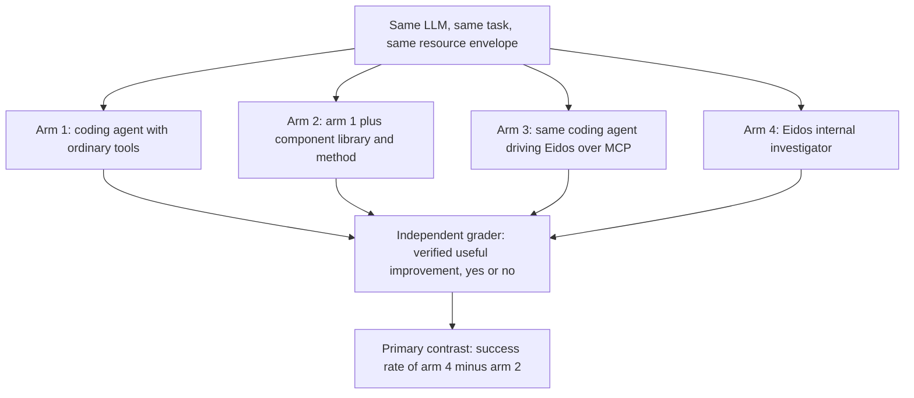
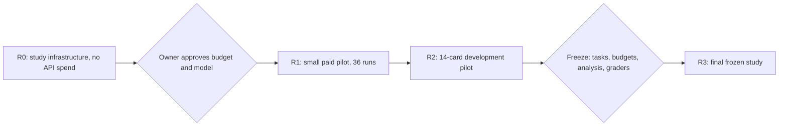
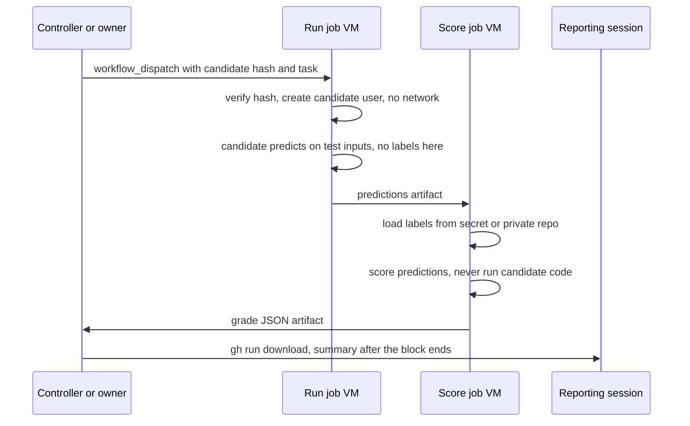

# Experiments and testing plan (R0–R3)

This is the working plan for the people who test Eidos and run its research study: the owner and a teammate. It takes about ten minutes to read. It assumes you know ML engineering but have never seen Eidos.

Contents: [current status](#current-status-2026-11-13) · [development gates](#development-gates) · [the original plan](#the-original-plan-2026-11-09) · [what and why](#what-we-are-testing-and-why) · [study at a glance](#the-study-at-a-glance) · [phases](#phases-and-checklists) · [GitHub](#how-we-use-github) · [grading](#grading-on-github-actions) · [roles](#roles-who-does-what) · [open decisions](#decisions-still-open-for-the-owner) · [ground rules](#ground-rules) · [getting started](#getting-started-for-the-teammate)

## Current status (2026-11-13)

Eidos v1.1.0 is the latest release. `main` also carries unreleased round-4 and R5 runtime changes (see the [changelog](../../CHANGELOG.md)).

- **Pilots 1 to 3 ran as a four-arm study.** They are exploratory development pilots. Results are in the [Research](../../README.md#research) and [Benchmarks](../../README.md#benchmarks) sections of the README and in the paper in [`docs/paper/`](../paper/).
- **From Pilot 4, each pilot runs two arms:** the Eidos investigator (arm 4) against a coding agent given the Eidos toolkit (arm 2). Arms 1 and 3 were dropped after Pilot 3. The primary contrast was always arm 4 against arm 2. The MCP arm was diagnosed as limited by its plumbing rather than by the harness. Two fewer arms also halves the cost of each paired comparison, which buys six paired runs per card instead of three. The decision rule is unchanged.
- **Pilot 4 is registered and has not run.** Its [registered charter and design](https://github.com/Legend101Zz/Eidos/tree/f40f03c0dd522da39f27d8ed6852a0dcb087da97/docs/experiments/pilot-4) are pinned to commit `f40f03c`: cards N05–N08, 24 paired blocks (48 assignments), admission window 16 to 19 November 2026 UTC. As of 13 November 2026 there are no Pilot 4 results.

## Development gates

A development gate is a paired check of a new Eidos build, run between pilots. It is not one of the numbered pilots.

- **Design.** Arm 4 only, one seed, the same model and per-run envelope as the pilots (MiniMax-M3.1-Flash; 1,800 s, 8M processed tokens, one CPU thread) and seven development cards (N01–N04, D02–D04). The frozen baseline build `257792a` runs the same cards for comparison.
- **Rule fixed before launch.** Gate G-R5 required 7 of 7 candidate conclusions, zero dead ends, the existing evidence checks, and a zero-tolerance comparator against the baseline. Its registration says a failed gate is recorded and diagnosed, then followed by a fix and a new registration, and is never re-run, reinterpreted or waived.
- **G-R5.** Registered before it ran ([registration](https://github.com/Legend101Zz/Eidos/blob/0ef3058df707e1c6699b2d6384cb8cf76b232f03/docs/experiments/development-gates/GATE-R5.md), pinned to commit `0ef3058`) and passed on build `86dfe57` (R5, [ADR 0042](../decisions/0042-split-conclude-only-reserve.md)). Earlier gates, including the one for round-4 build `a7c5d19`, failed. The full record is in the README's [Benchmarks](../../README.md#benchmarks) section.
- **Limits.** One seed on seven cards that were already used for tuning is development evidence about the harness, not an estimate of performance.

## The original plan (2026-11-09)

The rest of this page is the original plan. It was written on 2026-11-09, before any pilot ran, and is kept as written. Its four-arm design, its R0–R3 phase sizes and its checklists have not been brought up to date, apart from short notes marked **Update**. They do not describe what the pilots actually did: each pilot's own charter and addenda in this directory record that.

Original status text, 2026-11-09: Eidos v1.0.1 was released and v1.1.0 was prepared (harness features only, no experiment). At that date no comparative experiment had been run. Nothing in the plan is a result; it is what we planned to do and the rules we hold ourselves to. The source of truth for the original study design is [`research/public/STUDY_PROTOCOL.md`](../../research/public/STUDY_PROTOCOL.md) (charter draft 0.3). Where this page and the protocol disagree about the original design, the protocol wins.

## What we are testing, and why

We test two different things. Keep them apart: a pass in one says nothing about the other.

| | (a) Harness testing | (b) Research experiments |
|---|---|---|
| Question | Does the software behave correctly? | Does the same LLM make more independently verified, useful model improvements through Eidos than as a well-equipped coding agent? |
| Examples | Crash recovery, sandbox isolation, budget enforcement, upgrades, MCP clients | A comparison of arms on PyTorch tasks, graded by an independent grader (four arms in the original plan and in Pilots 1 to 3; two arms from Pilot 4) |
| Where it lives | CI (15 jobs), `tests/`, the acceptance matrix ([`ACCEPTANCE_MATRIX.md`](../../ACCEPTANCE_MATRIX.md)) | This plan, `research/public/`, a private grading repo |
| Status | v1.0.1 passed its release gates (see the [README](../../README.md#status-and-evidence)); machine sleep/restart is not yet verified on hardware | **Update (2026-11-13):** three exploratory development pilots have run and Pilot 4 is registered but has not run (see [Current status](#current-status-2026-11-13)). Original text: "Not started." The acceptance matrix lists it as A16, a separate later release |

Question (b) is the question of the [paper](../paper/). The design states it in the section "Complete local v1 and scientific acceptance" of [`model-research-harness-design.md`](../design/eidos-claude-handoff/architecture/model-research-harness-design.md).

Why it matters: an LLM agent doing ML research can fiddle until a number goes up, grade its own work and over-claim. Eidos is built to stop that (success rules fixed in advance, an independent assessor, a ledger of every run and exposure). Whether that discipline produces *more verified improvements* than a capable coding agent with the same tools is an open, testable question. It may not.

## The study at a glance

**Update (2026-11-13):** Pilots 1 to 3 used the four arms below. From Pilot 4 only arms 2 and 4 run, for the reason given in [Current status](#current-status-2026-11-13). The primary contrast and the decision rule are unchanged.

**Four arms.** Every arm uses the same underlying LLM, the same settings, the same task information and the same resource envelope (time, tokens or dollars, CPU, memory).

| Arm | What the LLM gets |
|---|---|
| 1 | A coding agent (Claude Code or Codex) with a research brief and ordinary tools: shell, editor, Python, search |
| 2 | Arm 1 plus the frozen component library and the written research method, callable directly, **without Eidos** |
| 3 | The same coding agent operating Eidos through MCP, with the same library and method |
| 4 | The Eidos internal investigator, with the same library and method |



**Primary contrast: arm 4 minus arm 2.** Arm 2 already has the library and the method, so this contrast asks what the Eidos service itself adds. The secondary contrasts are 2−1 (library and method), 3−2 (service access) and 4−3 (investigator policy).

**What counts as one success.** A run succeeds only if its locked candidate model:
- beats the supplied working baseline by the task's practical gain, fixed before exploration;
- meets every guardrail (for example, no more than a set accuracy drop on critical slices);
- reproduces under the independent grader;
- stays within the claim scope it declared.

An invalid, timed-out, over-budget or missing output counts as **no success**. A null task (no real improvement exists) is scored for honest abstention, not counted as a free success.

**The decision rule (+10 points).** The owner approved this on 7 November 2026, before any comparative result. The difference in success rate, arm 4 minus arm 2, must be at least **10 percentage points**: one more verified success per ten attempts.

| 95% confidence interval for (arm 4 − arm 2) | What we may say |
|---|---|
| Lower end above +0.10 | Eidos gives a practically useful advantage |
| Lower end above 0, but not above +0.10 | A smaller advantage only |
| Point estimate above +0.10, interval includes 0 | Inconclusive |

The protocol adds an admission gate: the current bootstrap interval is not yet calibrated for few project families, so it cannot be used for a confirmatory claim as it stands.

**An honest note on statistical power.** From the protocol's sensitivity calculation: confirming a +10-point advantage with 80% power (when the true advantage is +20 points) needs about **280 independent task pairs**, before any correlation between related tasks. With **40 pairs** the 95% interval is about **±20 points** wide. So the early phases are **exploratory**: they test the protocol, the tools and the costs. They cannot confirm or refute the claim.

## Phases and checklists



Each phase ends with a short written review in a PR before the next starts. Results from R1 and R2 are development evidence and are labelled as such forever.

**Update (2026-11-13):** the phase sizes and checklists below are the plan as written on 2026-11-09. The pilots that ran differ from them in size and cards, and each pilot's charter records what it did. The checkboxes were not ticked or revised.

### R0: study infrastructure (no API spend)

Nothing in R0 calls a paid model. Use stub agents and the existing fixture policies.

- [ ] **Arm-2 standalone component toolkit.** The built-in components (`components/`, for example `eidos.pytorch.train`, `eidos.pytorch.evaluate`, `eidos.pytorch.weight-edit`, `lab.pairs.by_group`) packaged so a coding agent can call them without Eidos, plus the written research method as a document. The protocol requires a callable equivalent for every public scientific component that arms 3 and 4 get.
- [ ] **Budget-metered runner for arms 1–3.** Wrappers for Claude Code and Codex that enforce the same limits on tokens or dollars, CPU, memory and wall time, stop at the first exhausted limit, and record actual usage. Arm 4 uses Eidos's own budgets (`model_usd`, `model_tokens`, `turns`, `compute_seconds`); the runner applies the same outer envelope to it.
- [ ] **Study launcher.** Builds paired, randomized and interleaved blocks (one block = one task and run, all four arms). Includes:
  - a provider-version guard: log the model identifier each response returns; if it changes, suspend the block and re-run all four arms under one version;
  - incident replacement: an infrastructure failure replaces the whole paired block, blinded, and keeps the incident record and its cost;
  - intention-to-evaluate bookkeeping: every assigned run stays in the denominator.
  - Output: the `--design` and `--results` JSON files that [`research/public/development/analyze_results.py`](../../research/public/development/analyze_results.py) reads (fields `family`, `task`, `run`, `arm`, `primary_eligible`, `verified_success`, `status`, `billed_usd`; unknown cost is `null`, never 0).
- [ ] **Private grading repo** with the two-job workflow described [below](#grading-on-github-actions).
- [ ] **Grader qualification.** Before the grader may score any arm, show that it detects planted effects (a candidate known to beat the baseline by the practical gain), stays silent on null cases (no-change predictions, the D12 null card), rejects invalid predictions (missing or duplicate IDs, non-finite values), and records an infrastructure failure as an incident.
- [ ] **AIDE comparator setup.** Pin AIDE (the protocol lists commit `ad73d22`), configure its code, feedback and report models explicitly, and choose its compatible task subset in advance. AIDE is an extra comparator, reported separately; it does not replace an arm.
- [ ] **Dry run.** One full launcher → runner → grading → `analyze_results.py` pass with stub agents and no model calls.

### R1: small paid pilot

- **Scope:** cards D01, D02 and D12 × 4 arms × 3 runs = **36 runs**, each with a 30-minute envelope.
- **Cost estimate:** the three real-model Eidos runs for v1.0.0 (`claude-sonnet-5-5` on the switch-order example) cost USD 1.36, 2.04 and 1.81 ([`a8-sonnet-*.json`](../release/evidence/)). 36 runs at USD 1.5–2 is about USD 55–75; we plan for **USD 50–150** because the coding-agent arms have no cost data yet and an incident re-runs a whole block. Needs the owner's budget decision first.
- **What it tests:** the protocol, the tools and real costs. **Not Eidos.** D01 is an import task (no improvement claim) and D12 is a null control, so only D02 is an improvement card. Three tasks cannot estimate the primary contrast.
- [ ] Owner approves the model, settings and budget ceiling ([decisions](#decisions-still-open-for-the-owner)).
- [ ] Charter revision records the shared model and envelope before the first run.
- [ ] 36 runs launched in randomized, interleaved blocks; every run recorded, including failures.
- [ ] Grading on GitHub Actions; results summarized by a reporting-only session.
- [ ] Written review: cost per arm, failure reasons, protocol fixes.

### R2: full development pilot

- [ ] All 14 development cards ([`TASK_SELECTION_PUBLIC.csv`](../../research/public/TASK_SELECTION_PUBLIC.csv), [`tasks/`](../../research/public/development/tasks/)) × 4 arms × 3 runs, at 30-minute and 2-hour envelopes after timing qualification.
- [ ] Remember: the 14 cards share 8 project clusters, so they are not 14 independent tasks.
- [ ] AIDE on its pre-chosen subset.
- [ ] Simulate the planned family/task/run design to choose the R3 size from precision and affordable cost. Do not shrink the +10-point margin to fit a pilot.

### R3: final frozen study

- [ ] Freeze, before any final run: tasks and splits, budgets, repetitions, system versions, prompts, analysis code, interval method, exclusion rules, grader versions.
- [ ] Select final tasks by eligibility, family quotas and a committed random procedure, never by observed arm advantage. The protocol's starting point is 40 projects across at least 8 families with 3 runs per arm (480 runs); it is not a powered sample.
- [ ] Independent grader qualification and an access-isolation audit pass (admission gates).
- [ ] One round with frozen systems and no adaptive feedback.
- [ ] Release outcomes only under the agreed disclosure policy.

## How we use GitHub

**Issues, labels and milestones.** Work is tracked in issues in the milestone **"R0: study infrastructure"**. Labels:

| Label | Meaning |
|---|---|
| `research` | study design and research experiments |
| `harness` | the Eidos software itself |
| `ci` | the CI workflow |
| `grading` | the private grading repo and grader |
| `docs` | documentation |
| `phase:R0`, `phase:R1` | which phase the work belongs to |
| `decision` | a decision the owner must make |

Tracking issue: [#15](https://github.com/Legend101Zz/Eidos/issues/15) "Experiments and testing plan (R0-R3)". R0 issues and decision issues:

| Issue | Labels | What |
|---|---|---|
| [#3](https://github.com/Legend101Zz/Eidos/issues/3) | research, phase:R0 | arm-2 standalone component toolkit and written research method |
| [#4](https://github.com/Legend101Zz/Eidos/issues/4) | research, phase:R0 | budget-metered runner for arms 1-3 (Claude Code and Codex wrappers) |
| [#5](https://github.com/Legend101Zz/Eidos/issues/5) | research, phase:R0 | study launcher (paired randomized blocks, version guard, incidents, intention-to-evaluate) |
| [#6](https://github.com/Legend101Zz/Eidos/issues/6) | grading, ci, phase:R0 | private grading repo and two-job grading workflow |
| [#7](https://github.com/Legend101Zz/Eidos/issues/7) | grading, research, phase:R0 | grader qualification with planted effects and null cases |
| [#8](https://github.com/Legend101Zz/Eidos/issues/8) | research, phase:R0 | AIDE comparator setup |
| [#9](https://github.com/Legend101Zz/Eidos/issues/9) | decision, research | shared model and settings for all four arms |
| [#10](https://github.com/Legend101Zz/Eidos/issues/10) | decision, research | R0-R1 budget ceiling |
| [#11](https://github.com/Legend101Zz/Eidos/issues/11) | decision, research | grading hardware for the final study |
| [#12](https://github.com/Legend101Zz/Eidos/issues/12) | decision, research | disclosure policy and external preregistration |
| [#13](https://github.com/Legend101Zz/Eidos/issues/13) | decision, research | data licences of the development cards |
| [#14](https://github.com/Legend101Zz/Eidos/issues/14) | decision, research | seven open questions from the earlier design review |

**Branches and PRs.**
- Branch from `main` as `task/<short-name>`. CI runs on every push to `task/**` and `release/**`.
- Open a PR into `main`. The PR's own `pull_request` CI run shows as **skipped** for branches in this repo; that is expected, because the push run already built the same commit. Read the push run.
- The owner reviews and merges. Do not merge your own PR and do not force-push shared branches.
- Commit as your own GitHub identity (see [ground rules](#ground-rules)).

**What each CI job checks** (`.github/workflows/ci.yml`; details in [`docs/ops/CI.md`](../ops/CI.md)). **Update:** this table lists the ten jobs that existed on 2026-11-09. CI now runs 15 jobs (see the [README](../../README.md#status-and-evidence)), and a separate `study-evals` workflow runs on pull requests that change `study/`.

| Job | In plain words |
|---|---|
| `lint-and-unit` | Style (ruff), import boundaries, type checks (mypy), wire schemas up to date, shell script checks, unit, MCP and report tests |
| `integration` | Tests against a real PostgreSQL 16 and a Temporal dev server |
| `worker-compat` | The worker packages install and work in old (Python 3.9, Pydantic 1) and current (Python 3.12 with torch) project environments, without server dependencies |
| `components` | Every built-in component runs through the worker SDK with CPU torch; any skipped test fails the job |
| `fresh-install` | Build the wheels, install into a clean environment, and run the lab life cycle: init, start, doctor, project, status, stop |
| `macos-arm64-smoke` | The same on a macOS runner, plus Seatbelt sandbox probes, worker SDK tests and the research-release smoke check. Lab steps are informational there; the SDK and research steps must pass |
| `upgrade-across-releases` | A v0.1.0 lab with real data is upgraded in place to the current code; old data must stay byte-identical and readable |
| `e2e-journey` | A scripted user journey: D01 bundle import, a scripted investigation, a checkpoint branch, export, an MCP client, reports |
| `switch-journey` | The full 154-check switch-order acceptance journey, including a worker kill and recovery |
| `temporal-source-fallback` | Builds the pinned Temporal server from source and runs the lab life cycle, so we do not depend on a download CDN |

**Reading a red job.**
1. Open the run (`gh run view <run-id> -R Legend101Zz/Eidos`, or the Actions tab) and find the first failed step.
2. If it failed while **downloading** (setup-uv, the Temporal archive, apt) with HTTP 502/504 or "Bad Gateway", it is the known GitHub CDN flake. Re-run only the failed jobs: `gh run rerun <run-id> --failed -R Legend101Zz/Eidos`. See [`TROUBLESHOOTING.md`](../ops/TROUBLESHOOTING.md).
3. If a test step fails, or a download fails twice, treat it as real. Jobs upload logs as artifacts on failure: `gh run download <run-id> -R Legend101Zz/Eidos`.

**Eidos's own release flow.**
1. Release work happens on `release/X.Y.Z` and reaches `main` through a PR with green CI.
2. The owner tags the merge commit `eidos-vX.Y.Z` (latest at the time: `eidos-v1.0.1`; the latest tag now is `eidos-v1.1.0`).
3. The owner creates the GitHub release and attaches the wheels, source archives and `SHA256SUMS`. There is no release workflow; this step is manual.
4. Users install with `gh release download eidos-v1.0.1 -R Legend101Zz/Eidos`, check `shasum -a 256 -c SHA256SUMS`, then install as in the [README](../../README.md#install).

Tags starting `eval-*` are reserved for the later scientific release. The public research package has its own release identity, `research-public-v0.1.0` (in `research/public/PUBLIC_MANIFEST.json`); it is not a git tag.

## Grading on GitHub Actions

The owner approved this design. A ready-to-adapt workflow is in [`grading-workflow.example.yml`](grading-workflow.example.yml); its `.example.yml` name keeps it from running here. It belongs in the private grading repo.

**Why a separate private repo.** Logs and artifacts of a public repo are public. Labels, grades and candidate outputs must not be.

**Two jobs on two fresh VMs.** Each grading run is:
1. **Run job.** Runs the candidate model on the test inputs and writes predictions.
   - No secrets in this job, and no labels on this VM.
   - Candidate code runs as a separate OS user (created with `sudo useradd`), inside bubblewrap with no network.
2. **Score job.** Gets the labels (from a repository secret or the private repo), scores the predictions and writes `grade.json`.
   - It reads predictions as data. It **never executes candidate code**.

**Who can trigger it.** Only the controller or the owner, by `workflow_dispatch`. Candidates are named by their SHA-256 content hash, and the run job checks the hash. Agents never get a token for the grading repo.

**Failures.** An infrastructure failure (for example HTTP 504 while setting up the runner) is an **incident**. It triggers a blinded replacement of the whole paired block and never counts as a candidate failure. A candidate that crashes, times out or writes invalid predictions is a candidate failure: no verified success.

**Getting results back.** Results come back as a JSON artifact. A script, or a **reporting-only** Claude session, fetches them with `gh run download <run-id> -R <owner>/<grading-repo> -n grade-<run-tag>` and summarizes. The reporting session must never pass grades into a session that is still running an arm (blinding).



**Limits.**
- Standard GitHub-hosted runners are CPU-only. GPU tasks need other hardware ([open decision](#decisions-still-open-for-the-owner)).
- Timing on shared runners is noisy. Do not grade runtime-reduction tasks on them without repeated measurements.
- A job runs for at most 6 hours.
- Actions minutes for private repos count against the account's plan allowance.

## Roles: who does what

*A suggestion for the owner to confirm or change.*

| Area | Owner | Teammate |
|---|---|---|
| Open decisions (model, budget, hardware, disclosure, licences) | decides | prepares options |
| Arm-2 toolkit and written research method | leads (it defines fairness between arms) | reviews, packages |
| Budget-metered runner, study launcher | reviews | builds |
| Private grading repo, grader qualification | reviews, holds the labels | builds |
| AIDE comparator setup | reviews | builds |
| Charter revisions, freezes, launching R1 | decides | prepares |
| Controller during runs, PR merges | does | — |

## Decisions still open, for the owner

Each has a `decision` issue (see [GitHub](#how-we-use-github)). **Update (2026-11-13):** this list is as written on 2026-11-09 and has not been revised. The pilots have since run with MiniMax-M3.1-Flash as the shared model.

1. **The shared model and settings for all arms.** The charter allows MiniMax or Codex models. Eidos has qualified only Anthropic: its OpenAI-compatible adapter works, but no tested model passed full conformance ([`SUPPORTED.md`](../release/SUPPORTED.md)). Arm 4 needs a model that Eidos supports.
2. **The R0–R1 budget ceiling.** No research spend is authorized yet; the $200 implementation allocation is not a research budget.
3. **Grading hardware for the final study.** CPU runners only, or GPUs for some tasks?
4. **Disclosure policy and external preregistration.** The local hash commitment in the public manifest is not a preregistration.
5. **Data licences of the development cards.** Currently "publication license undecided" in `TASK_SELECTION_PUBLIC.csv`.
6. **Seven open questions from the owner's earlier design review.** Pending owner answers; they are not in this repo.

## Ground rules

1. **Lock success rules before results.** Practical gains, guardrails and the analysis are fixed before the comparison they govern.
2. **Never look at labels or grades while an arm is running.** That includes the reporting session and the humans.
3. **Record every run, including failures.** Timeouts, crashes and incidents stay in the denominator and the cost totals.
4. **A changed threshold applies only prospectively.** It is tested on later, fresh data and keeps its exposure history. A new study ID does not erase what was seen.
5. **Commit as your own GitHub identity.** Use your own name and GitHub email (or your GitHub noreply address).

## Getting started for the teammate

Every command below was run on 2026-11-09 against a fresh clone of `main` (18c38e5) on macOS arm64, with all output on external storage. Times are from that run, with warm package caches.

**1. Clone.**

```bash
git clone https://github.com/Legend101Zz/Eidos && cd Eidos
git log --oneline -1        # 18c38e5 Merge pull request #2 from Legend101Zz/release/1.0.1
```

**2. Install the lab from source** (as in the [README](../../README.md#install)). Needs Python 3.12 and [`uv`](https://docs.astral.sh/uv/).

```bash
uv build --no-cache --all-packages -o dist        # 4 wheels + 4 sdists
uv venv --python 3.12 ~/eidos-venv
uv pip install --no-cache --python ~/eidos-venv/bin/python --find-links dist eidos-lab
~/eidos-venv/bin/lab --help                        # "Usage: lab [OPTIONS] COMMAND [ARGS]..."
```

The worker packages are versioned separately: `eidos-lab` and `eidos-wire` are 1.0.1, `eidos-worker-sdk` and `eidos-pytorch` are 1.1.0. Running a lab (`lab init`, `lab start`) needs PostgreSQL 14+ server binaries and downloads the pinned Temporal Server; see the README quickstart. The commands below do not need either.

**3. Run the fast checks and unit tests** (from the repo root).

```bash
uv sync
uv run ruff check src tests && uv run lint-imports     # "All checks passed!", "Contracts: 5 kept, 0 broken."
uv run pytest tests/unit tests/mcp tests/reporting -q  # 110 passed, 1 skipped (the live-lab MCP test), ~15 s
bash scripts/ci/mypy.sh                                # two "Success: no issues found" lines, ~2 min; first run fetches mypy 1.19.1
```

Need PostgreSQL or Temporal, so not run here: `tests/integration` (needs a PostgreSQL superuser URL and a Temporal CLI, see the README's Development section), `tests/journeys/run_ci.sh` (the switch journey), `scripts/ci/fresh_install.sh` and `scripts/ci/lab_cycle.sh`. `tests/journeys/a8_live.py` makes **paid** model calls; do not run it without the owner's approval.

**4. Run the development bundle smoke check** (the first commands of [`BUILDER_HANDOFF.txt`](../../research/public/BUILDER_HANDOFF.txt)). Use a virtual environment outside `research/public/`, which is immutable.

```bash
cd research/public/development
python3.12 -m venv ~/research-venv
~/research-venv/bin/python -m pip install -r requirements.lock      # torch 2.15.0, numpy, scikit-learn...; about 1 GB
~/research-venv/bin/python check_bundles.py --out /tmp/eidos-smoke   # {"bundle_cases_passed": 3, "negative_controls_passed": 2}, ~2 min
~/research-venv/bin/python check_analysis_and_answer.py              # "... controls passed; synthetic inputs only."
~/research-venv/bin/python package_task.py --task D02 --out /tmp/eidos-D02
~/research-venv/bin/python /tmp/eidos-D02/project.py train --inputs /tmp/eidos-D02 --out /tmp/eidos-baseline --seed 11
cd ../../..
```

The last command trains the D02 baseline on CPU in about 10 seconds and writes `model.pt`, `receipt.json` and `validation_predictions.npz`. Afterwards, `git status` should show no changes (`__pycache__/` is ignored by `.gitignore`).

**5. Open a PR.**

```bash
git switch -c task/<short-name>
# ... make your change ...
git add <files> && git commit -m "<what changed and why>"
git push -u origin task/<short-name>
gh pr create --base main --fill
```

Then wait for the push run of CI to go green, and read [`CONTRIBUTING.md`](../../CONTRIBUTING.md). Pick your first issue from the [R0 milestone](https://github.com/Legend101Zz/Eidos/milestone/1).
